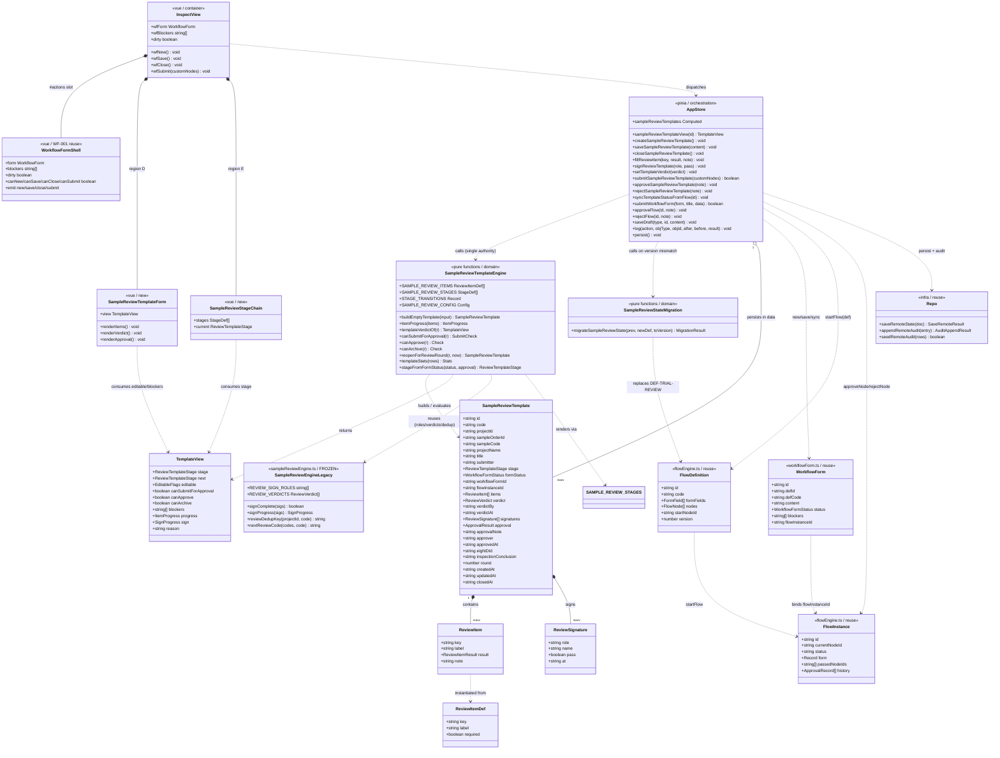
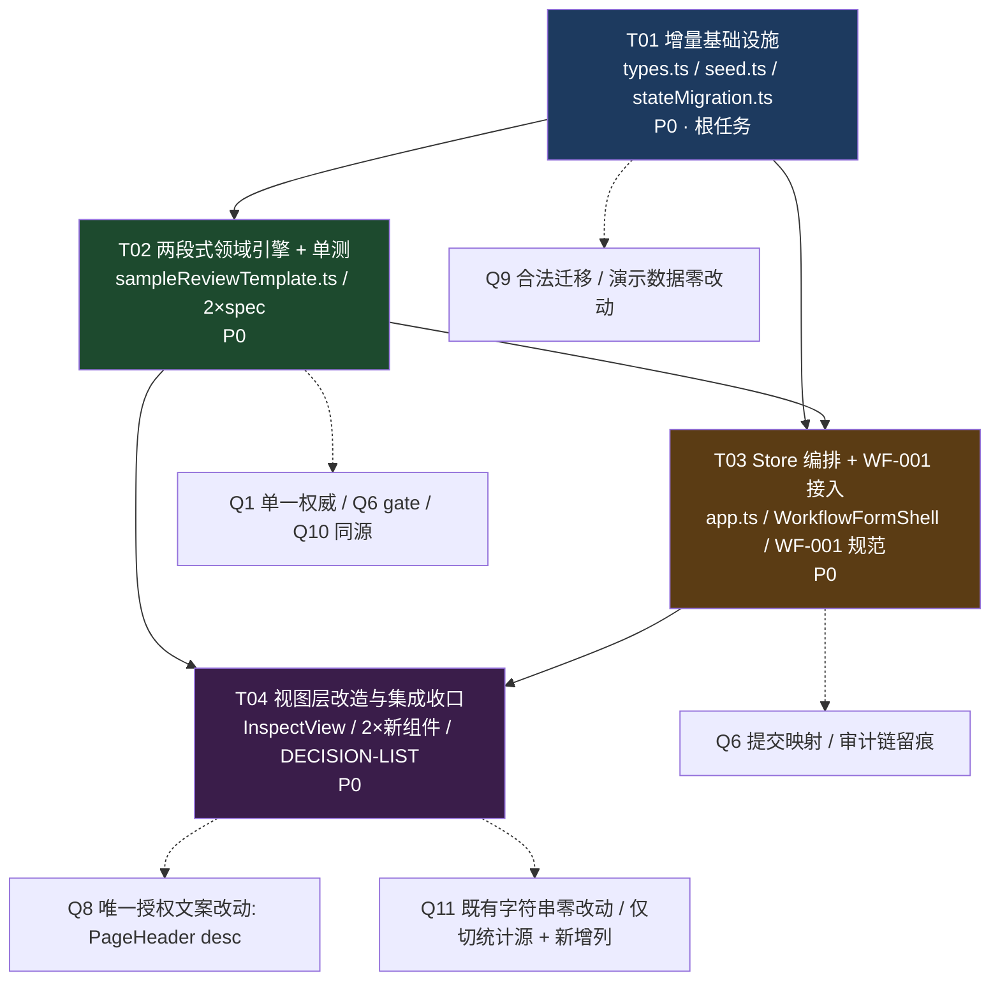

# 增量系统设计 · 样件评审模板（评审 + 审批）

> 文档类型：增量架构设计 + 任务分解　|　版本：**v0.3（主理人复核裁决已并入）**　|　日期：2026-11-24
> 撰写：高见远（架构师）　|　交付：齐活林（主理人）→ 转交工程师
> 状态：**设计定案稿**，仅描述技术方案与任务分解；本次不改任何业务代码、不运行门禁
> v0.2 变更：用户已拍板 **Q8（授权改 PageHeader `desc` 一处文案）** 与 **Q2/Q3/Q4/Q7 默认业务口径（全部采纳为定案）**；原 v0.1 中「Q8 一字不动」「默认口径为待定参数」的指示**作废**。
> v0.3 变更（主理人 2026-11-24 复核裁决，6 处）：① Q8 明确为「`desc` 是**本次唯一被授权修改的既有文案**，`title`/菜单/其余既有文案仍一字不动」；② `DEF-TRIAL-REVIEW` 的 `id`/`code`/`name` **保持原样**（`name` 仍为「样件评审流程」），只改 `nodes`/`formFields`/`version`；③ **Q11 收紧既有文案**：KPI 4 卡 `label` 与列表既有列名/顺序一律保留，仅统计源切到 `templateStats`、只允许新增列；④ §0.2 基线补全实测值 + 变化来源 + `.gitignore` 跟踪说明；⑤ U1/U3/U5/U6 由「待确认」改为**已定案**（含不新增「提交审批」按钮、Q5 核心能力仍 P0、1796 口径）；⑥ §6 中「需用户确认」措辞改为「用户已定案」。详见 §0.4 / §6 / §5。
> v0.3 精确纠错（主理人 2026-11-24 追加，仅 5 处 + 1 条优先级说明）：① §3.1 `kpiLabels` 对齐既有 4 卡 `label` 原字符串与 `templateStats` 键名（`total/reviewing/pending/closed`）；② §5 Q8 边界句删除「KPI 标签调整属 Q11 架构师定案」并改为「除 `desc` 外既有字符串零变化」；③ §5 Q11 / §11.3 删除「7 列 / 当前阶段 / 评审结论」列口径，统一为「保留既有 6 列及其顺序 + 只允许新增列（如「审批结果」）」；④ §0.4 补用户裁决优先级说明；⑤ §3.3 / §3.4 复核 `DEF-TRIAL-REVIEW.name` 保持原样。其余定案（Q1/Q5/Q6/Q9/Q10、合并式迁移、U1/U3/U6、实测基线 rev=4 / 18 条、QA diff 核对）全部不变。
> 系统 / 品牌名：魔程化解研发项目管理系统（MOFENG-RDP）—— **固定不变，严禁增删改**
> 增量代号：`mofeng_rdp_sample_review_template_increment`
> 上游输入：`docs/PRD-SAMPLE-REVIEW-TEMPLATE-2026-11-24.md`（许清楚，v0.1，已逐字核对）
> 承载位置：既有 `/trial/inspect` 页面；**不新增菜单 / 路由 / 页面**

---

## 0. 设计输入与核实基线（实测，禁止虚构）

### 0.1 已逐一读过的落点文件

| 文件 | 核实内容 |
| --- | --- |
| `docs/PRD-SAMPLE-REVIEW-TEMPLATE-2026-11-24.md` | PRD 全文 133 行，与转交原文一致 |
| `app/src/domain/sampleReviewEngine.ts` | 五态引擎 `ReviewPhase` / `PHASE_TRANSITIONS` / `REVIEW_SIGN_ROLES` / `REVIEW_VERDICTS` / `REVIEW_CLOSURE_FIELDS` / `canCloseReview` / `evaluateReviewAdvance` / `reviewVerdictOf` / `reviewDedupKey` / `buildSampleReview` |
| `app/src/domain/workflowForm.ts` | WF-001 状态机 `WorkflowFormStatus` / `newWorkflowForm` / `saveWorkflowForm` / `validateSubmit` / `markSubmitted` / `syncStatusFromFlow` / `reopenForEdit` / `canDo` / `draftContentFor` |
| `app/src/domain/flowEngine.ts` | `FlowDefinition` / `FlowNode` / `FlowBranch` / `FlowInstance` / `startFlow` / `staticNext` / `evalBranch` / `advanceThroughBranch` / `approveNode` / `rejectNode` / `signNode` / `availableActions` |
| `app/src/data/seed.ts` | `:94` `SEED_VERSION='mofeng.rdp.v1.0.41'`；`:955` `sampleReviews: []`；`:1000` `flowDefinitions:[`；`:1433~1456` `DEF-TRIAL-REVIEW`（rv1 start→rv2 检验确认→rv3 会签→rv4 总监批准→rv5 评审结论→rv6 end） |
| `app/src/store/app.ts` | `:70~80` 旧引擎 import；`:327` `sampleReviews` computed；`:517~537` `persist()`；`:558~600` `syncFromBackend()` 版本迁移；`:782~802` `log()` 审计；`:1364` `drafts`；`:3813` `saveDraft()`；`:4313~4535` 旧评审 8 动作；`:4787~4840` `flowDefinitions`/`launchFlow`/`submitWorkflowForm`；`:4843~4880` `approveFlow`；`:5148` `rejectNode` 调用；`:5352~5369` 与 `:5611~5622` 导出清单 |
| `app/src/views/trial/InspectView.vue` | 330 行；PageHeader `desc` 写旧「五态闭环」；右上角仅「+ 发起评审」；`op-grid` 四步流转；`REVIEW_PHASES` 五态链 |
| `app/src/components/WorkflowFormShell.vue` | 236 行；四按钮 + 状态徽章 + `dirty` + `blockers` + `slot`，**通用壳、零业务逻辑，可直接复用** |
| `app/src/views/project/PpapView.vue` | WF-001 参考实现（`#actions` 放 `WorkflowFormShell`、`wfNew/wfSave/wfClose/wfSubmit`、`serializeContent/hydrateContent`、gate blockers） |
| `app/src/domain/types.ts` | `:690~713` `DraftObjectType` 联合类型 + `FormDraft` |
| `app/src/infra/repo.ts` | `:131~158` `seedRemoteAudit` 幂等前置（后端 `count>0` 跳过）；`saveRemoteState` 409 乐观锁；`appendRemoteAudit` |
| `app/tests/sampleReviewEngine.spec.ts` | 264 行 / 40+ 断言，**唯一锁死旧五态语义的单测** |
| `app/tests/workflowForm.spec.ts`、`docs/WF-001-WorkflowForm-Spec.md` | WF-001 规范 §3.4 要求登记 `DraftObjectType`；§4「提交才启动审批」「提交前校验不可绕过」「状态机 fail-closed」 |
| `server/data/state-T-1001.json`、`audit-T-1001.json` | 只读解析，实测数据见 0.2 |

### 0.2 实测基线（主理人 2026-11-24 复核定案 · **以运行时实测为准**）

| 项 | **当前真实值** | 备注 / 处置 |
| --- | --- | --- |
| `state-T-1001.json` 顶层 `version` | `mofeng.rdp.v1.0.41` | 与本设计升级目标 `v1.0.42` 不同 → 触发合法迁移 |
| `state-T-1001.json` 顶层 `rev` | **4** | 旧快照为 2；**禁止硬编码 `rev=2` / `expectedRev:0`**；后端 `rev` 必须运行时动态读取（`backendRev`） |
| `audit-T-1001.json` | **18 条**，链校验 `chainOk=true`、`brokenAt=null` | append-only 哈希链（末 2 条为 `UPDATE「附件A归档」`）；`chainOk`/`brokenAt` 为**校验结论**而非文件内字段；旧快照 16 条；禁止硬编码条数 |
| 业务实体 | **1 项目 / 1 样件 / 1 试制单 / 3 采购单 / 1 草稿** | 完整、无缺失 |
| `data.flowDefinitions` | **36 条**，含 `DEF-TRIAL-REVIEW` | 合并式迁移只按 `id` 就地替换该条，其余 35 条原样保留 |
| `data.sampleReviews` | `[]` | 旧五态数据为空，冻结零影响 |
| `data.audit`（内嵌） | 2 条 | 合并式迁移原样保留 |
| `server/data/` git 跟踪 | **不在 git 跟踪内**（`.gitignore:16` = `server/data/`），`git status` 干净（仅本次新增 4 个 docs 为未跟踪文件） | 演示数据属运行时数据、不入库；`server/data/*.json` 零改动指内容不被手工编辑 |

> **变化来源（主理人复核结论，非误删）**：上一轮**重启服务并打开前端预览**后，前端正常播种使 `rev` 由 2 → 4、审计链由 16 → 18（append-only 追加 2 条 `UPDATE「附件A归档」`）；业务实体完整、链健康（`chainOk=true`、`brokenAt=null`）。因此 `rev` / 链长的差异是**合法运行时演进，不是演示数据被破坏**。
>
> **统一口径**：**以运行时实测为准，后端 `rev` 动态读取**；`rev`、审计条数一律不得写入代码常量；`seedRemoteAudit` 幂等前置（后端非空链跳过）保证 `audit-T-1001.json` 零改动、链健康保持。

### 0.3 关键查证结论（决定 Q1 定案）

- `app/tests/**` 中**没有任何**用例引用 `DEF-TRIAL-REVIEW` / `FLOW-TRIAL-REVIEW` / `rv1~rv6` / `flowDefinitions` / `SEED_VERSION` / `createSampleReview` / `closeSampleReview` / `InspectView`。→ **改造流程定义数据、升级种子版本、改造 store 编排，对既有单测零冲击**。
- 唯一锁死旧五态语义的是 `sampleReviewEngine.spec.ts`（`REVIEW_PHASES` 顺序、`reviewCanTransition`、`canCloseReview` 四要素、`evaluateReviewAdvance`、`buildSampleReview` 初始阶段等 40+ 断言）。→ **只要不动 `sampleReviewEngine.ts`，这部分基线全绿**。
- `sampleReviews` 在演示数据里为空数组 → 旧实体无历史数据迁移负担。

### 0.4 用户裁决（2026-11-24 · 主理人转达，优先级高于 v0.1 保守假设）

> 本次裁决**覆盖**原 prompt 中「Q8 按一字不动设计」「默认业务口径为待定参数」两条指示；架构师定案项不受影响。

| 裁决项 | 用户定案 | 对设计的影响 |
| --- | --- | --- |
| **Q8** | **仅授权修订 `app/src/views/trial/InspectView.vue` 的 PageHeader `desc` 一处描述性文案**：旧「样件评审流程（五态闭环）：检验数据确认 → 部门会签 → 总监批准 → 评审结论 → 关闭；不合格/拒收转 8D 整改后复评…」→ 新两段式语义「样件评审模板（评审 + 审批）：评审小组逐项评审并给出评审结论 → 将该结论提交审批 → 批准归档 / 驳回复评」 | **本次唯一被授权的文案改动**。PageHeader 标题「样件评审」、侧栏菜单、所有其他既有标题/菜单/文案**一律不动**。已写入 §2 文件清单、§8 T04 任务、§9 共享知识、§11 风险矩阵，供工程师与 QA 核对 |
| **Q2** | 评审项清单 **7 项**：外观 / 尺寸 / 关键性能 / 检验记录符合性 / 资料齐套性 / 风险与整改建议 / 8D 闭环状态；**配置化**（数据定义 + 引擎求值两段，不在视图硬编码） | 由「建议项」升格为**权威值**，写入 `SAMPLE_REVIEW_ITEMS` |
| **Q4** | 汇总评审结论 **三态**：认可 / 有条件认可 / 拒收；审批结果 **两态**：批准 / 驳回 | 由「建议」升格为**权威值**，写入 `SAMPLE_REVIEW_CONFIG` |
| **Q3** | 阶段二审批角色 **研发副总**（沿用 rv4「总监批准」角色口径），单人审批 | 由「待定」升格为**权威值**，写入 `DEF-TRIAL-REVIEW.sr3.approverRole` 与 `SAMPLE_REVIEW_CONFIG.approverRole` |
| **Q7** | 驳回后 **退回阶段一重新评审，复评轮次 +1**（**不是**退回草稿重开） | 由「默认」升格为**权威值**，`rejectBehavior='reReviewRound'`；`'reopenDraft'` 仅保留为配置层备选能力、本次不启用 |
| **仍由架构师定案** | Q1 / Q5 / Q6 / Q9 / Q10 / Q11 | 结论与理由见 §5.0 定案总表，v0.1 结论不变 |
| **Q8 精确边界（主理人复核）** | `desc` 是**本次唯一被授权修改的既有文案**；`title`「样件评审」、侧栏菜单、其余所有既有文案**仍一字不动** | §1.6 / §2 #6 / §5 Q8 / §8 T04 / §9 / §10 / §11.1 表述已统一 |
| **流程定义命名（主理人裁决）** | `DEF-TRIAL-REVIEW` 的 `id` / `code` / `name` **全部保持原样**（`name` 仍为「样件评审流程」），只改 `nodes` / `formFields` / `version` | 改名会出现在「流程与表单配置」列表与模板下拉，属于改既有名称、超出授权；§3.3 示例已改回原值 |
| **Q11 收紧（主理人裁决）** | **KPI 4 个 `label` 保持既有字符串不变，仅统计数据源切到 `templateStats`**（评审单 / 进行中 / 已闭环 / 待总监批准）。**列表保留既有 6 列及其顺序**（评审单号 / 样件 / 阶段 / 轮次 / 结论 / 会签），**只允许新增列**（如「审批结果」），不得把「阶段」改成「当前阶段」、「结论」改成「评审结论」 | **除 `desc` 外任何既有字符串一律不动**；架构师定案不得覆盖用户对文案的授权边界（见下方优先级说明）；新增 DOM / 新组件 / 新增列内可用新文案。已写入 §3.1 / §5 Q11 / §8 T04 / §9 / §11.3 |
| **Q5 优先级（主理人裁决）** | 「拒收/不合格须关联 8D 才允许提交（fail-closed）」、驳回复评 `round+1`、`reviewDedupKey` 复用 **仍为 P0 保留**；仅「8D 独立流程分支」等 P2 项本期不实现 | §5 Q5 / §5.0 总表 / §11.3（SR-13 升 P0）已同步 |
| **U1 / U3 / U5 / U6 定案登记（主理人裁决）** | U1 采纳幂等合并式迁移并授权修改 `store/app.ts` 的 `syncFromBackend()` 版本不符分支（替换全量 `buildSeed()` 覆盖），R1 回退保留；U3 **不新增**表单内「提交审批」按钮（四按钮「提交」即「提交审批」，按钮旁用新增说明文字写明「提交后进入审批阶段」）；U5 P2 项本期不实现、仅留接口/配置位；U6「1796/1796 全绿」= 既有 1796 全绿 + 新增用例全绿，总数 >1796 属正常、不得删改既有断言凑数 | 全部由「待确认」改为**已定案**，见 §6 定案登记表；§5 Q6 / §4.1 时序图 / `sequence-diagram.mermaid` 已同步 |
| **硬约束不变** | 不新增菜单/路由、品牌名与其余文案不动（除 `desc` 一处）、domain 纯函数零 DOM/vue/pinia、审计链服务端权威、六门禁全绿、`MOFENG_DATA_DIR` 隔离、`server/data/*.json` 零改动、发布口径「内测/演示版」 | 全文约束不变 |

> **优先级说明（主理人 2026-11-24 追加）**：**当架构师定案（Q11 等）与用户文案授权边界冲突时，以用户裁决为准**——除 `desc` 外所有既有字符串不动；新增 DOM / 新组件 / 新增列可用新文案。即：Q11 原拟的「KPI `label` 调整 / 列表既有列名与顺序调整」一律作废，`DEF-TRIAL-REVIEW` 的 `id`/`code`/`name` 保持原样；两段式语义只靠新增内容承载，绝不改写任何既有字符串。

---

# Part A · 系统设计

## 1. 实现方案与框架选型

### 1.1 核心难点

| # | 难点 | 约束来源 |
| --- | --- | --- |
| D1 | 用户要求「**先评审结论 → 再审批**」，而 `sampleReviewEngine.ts`（五态）与 `DEF-TRIAL-REVIEW`（rv4 批准 → rv5 结论）均为「先批准后结论」，**顺序相反** | PRD §0 / SR-01 |
| D2 | 项目治理铁律：**单一权威、不得双权威**；同源判定（判定逻辑 + 控制点评估两处同源）；配置驱动「数据定义 + 引擎求值」两段，不在视图硬编码 | SR-04 |
| D3 | 六门禁硬约束：vue-tsc 0 error / **vitest 1796/1796、114 文件** / vite build / smoke / e2e 33 PASS / audit chainOk true | 主理人硬约束 |
| D4 | 演示数据零改动 + 审计链服务端权威（append-only + 哈希链） + `SEED_VERSION` 合法迁移 | SR-04③ / Q9 |
| D5 | WF-001「新增/保存/关闭/提交」四按钮接入 `/trial/inspect`，且「提交」与「提交审批」语义必须映射清楚（Q6） | SR-03 / Q6 |
| D6 | 不改品牌名；**除 Q8 唯一授权的 `InspectView.vue` PageHeader `desc` 外**，既有标题/菜单/文案一律不动；不新增菜单/路由 | PRD §6 + 用户裁决（§0.4） |

### 1.2 Q1 定案：**「语义改造 + 分层隔离」**（等价于主理人倾向的「唯一权威两段式」，但避开 1796 基线冲击）

> **结论：改造，不是并存。改造落在「流程定义数据层 + 页面权威实体层」；`sampleReviewEngine.ts` 五态引擎降级为冻结兼容层，不重写、不删、不改其单测。**

三层处置，逐层收敛为**一个权威**：

| 层 | 处置 | 权威数 |
| --- | --- | --- |
| **流程定义层**（`flowDefinitions`） | **就地改造 `DEF-TRIAL-REVIEW`**（唯一一条样件评审定义）：节点顺序由「…rv4 总监批准 → rv5 评审结论 → rv6 end」改为「**start → 评审结论守卫(branch) → 阶段二·提交审批(approve 研发副总) → end**」，`version: 2`，`formFields` 增补 `verdict / itemCompletion / signoff`。**不新增第二条 FlowDefinition** | **1** |
| **领域引擎层** | **新增** `app/src/domain/sampleReviewTemplate.ts`：两段式业务阶段机 + 评审项清单 + 汇总结论 + 审批栏，`templateVerdictOf()` 一次求值给出 `{stage, verdict, approval, editable, blockers, canSubmitForApproval, canApprove, canArchive}`（**判定逻辑 + 控制点评估同源**）。**旧 `sampleReviewEngine.ts` 冻结**：不被页面/store 调用、不新建数据、不参与 KPI；仅 `REVIEW_SIGN_ROLES` / `REVIEW_VERDICTS` / `signComplete` / `signProgress` / `reviewDedupKey` / `nextReviewCode` 作为**同源纯工具函数被新引擎 import 复用**（不复制、不改动） | **1**（页面只读 `templateVerdictOf`） |
| **页面实体层** | `/trial/inspect` 权威实体从 `data.sampleReviews` **切换**为 `data.sampleReviewTemplates`（空白起步）。旧数组 `sampleReviews` 永不被页面读取/渲染/新建/统计 → 页面上一张单据只有一份 `stage` / `verdict` / `approval` | **1** |

**为什么不直接重写 `sampleReviewEngine.ts`（不推荐路径，明确排除）**：

1. 它被 `sampleReviewEngine.spec.ts` 40+ 断言锁死（五态顺序、跳态、关闭四要素、结论分流、统计、初始阶段）。改语义 → 既有用例必然全红；要「全绿」就得**同步改测试**，等于篡改 1796 基线，违反项目「回退验证纪律 / 零缺陷假阳性」，且 QA 阶段独立回归必然复现红灯。
2. `store/app.ts` 8 个旧动作（`confirmReviewInspection`/`signReviewNode`/`approveReviewDirector`/`concludeReview`/`closeSampleReview`…）与 `InspectView.vue` 全部依赖该引擎，重写会连锁改动 ~500 行，风险与收益不成比例。
3. 治理铁律要求的是**「同一张单据不出现两套矛盾口径」**，而非「代码库里不能有两个文件」。冻结旧引擎 = 它**不对任何页面单据求值**，因此不构成第二权威；而流程定义层通过就地改造保证**只有一条**样件评审流程定义。

> 若用户/评审小组坚持「连旧引擎文件也要物理删除或重写」，则必须同步重写 `sampleReviewEngine.spec.ts` 并请主理人/QA **重新确认「1796/1796」基线口径**——本设计列为不推荐路径，回退方案见 §11.2。

### 1.3 单一权威论证（对 SR-04 逐条）

| SR-04 验收点 | 本方案落点 |
| --- | --- |
| ① 一张单据只有一份阶段/结论/审批结果，不得两套并行流程/两套矛盾结论 | 页面只对 `data.sampleReviewTemplates` 求值 `templateVerdictOf`；`FlowInstance` 仅承载**阶段二审批**运行状态，经 `syncStatusFromFlow` **单向**回写 `formStatus`，不产生第二份 `verdict`；旧 `sampleReviews` 冻结不渲染；`flowDefinitions` 中样件评审定义唯一 |
| ② 判定逻辑 + 控制点评估两处同源 | `templateVerdictOf(review)` 单一函数同时输出阶段、可推进性、gate 阻断项、审批可用性、归档可用性、阶段显隐标志；视图**只消费返回值，不自行 if/else 判定状态** |
| ② 配置驱动 = 数据定义 + 引擎求值，不在视图硬编码 | 数据定义：`SAMPLE_REVIEW_ITEMS`（7 项）、`SAMPLE_REVIEW_STAGES`（两段链）、`STAGE_TRANSITIONS`（合法流转表）、`SAMPLE_REVIEW_CONFIG`（角色/态/口径）、`DEF-TRIAL-REVIEW`（FlowDefinition）；引擎求值：`itemProgress` / `templateVerdictOf` / `templateStats` |
| ③ 审计链服务端权威 | 复用 `store.log()` → `appendRemoteAudit()`（append-only + 服务端重算哈希）；新增/保存/评审/下达结论/提交/批准/驳回/复评**全部留痕**；`persist()` → `saveRemoteState({expectedRev})` |
| ④ DEF/引擎/seed 关系 | 见 §1.2 与 §5 Q1/Q9 定案 |
| ⑤ 演示数据零改动 / chainOk true / 六门禁全绿 | 见 §5 Q9 与 §11 |

### 1.4 框架与库选型（**零新增第三方依赖**）

| 能力 | 沿用既有 | 理由 |
| --- | --- | --- |
| UI 框架 | Vue 3 `<script setup>` + TS | 既有技术栈，不引入新技术栈 |
| 状态编排 | Pinia `useAppStore`（`app/src/store/app.ts`） | 四层 `views → store → domain ← infra` |
| 组件库 | Element Plus（`el-form`/`el-table`/`el-select`/`el-dialog`/`el-empty`/`el-badge`） | 既有暗色面板/栅格风格 |
| 四按钮壳 | `WorkflowFormShell.vue`（**复用，原则不改**） | WF-001 通用壳已具备四按钮/状态徽章/dirty/blockers/slot |
| 单据状态机 | `workflowForm.ts`（复用，`newWorkflowForm`/`saveWorkflowForm`/`canDo`/`syncStatusFromFlow`/`reopenForEdit`） | 不改其文件与单测 |
| 审批流 | `flowEngine.ts`（复用 `startFlow`/`approveNode`/`rejectNode`/`advanceThroughBranch`/`evalBranch`） | **不改其文件与单测**；条件分支能力现成 |
| 草稿 | `draftEngine.ts` + `store.saveDraft` / `clearDraft` + `types.ts` 登记 | POR-007 跨端续编 |
| 持久化/审计 | `infra/repo.ts`（`saveRemoteState` 乐观锁 / `appendRemoteAudit` / `seedRemoteAudit` 幂等） | 服务端权威 |
| 单测 | Vitest（纯函数直调，domain 零 DOM/vue/pinia） | ARC-001 |
| 后端 | Node 零依赖后端（`/api/state`、`/api/audit`） | 既有 |

### 1.5 架构模式

- **四层分层**：`views → store → domain ← infra`，domain 纯函数零 DOM/vue/pinia。
- **配置驱动两段式**：`数据定义（常量 + FlowDefinition）` → `引擎求值（templateVerdictOf）` → `视图渲染（消费返回值）`。
- **单一权威状态机**：业务两段阶段（`ReviewTemplateStage`）由新引擎唯一拥有；WF-001 单据状态（`WorkflowFormStatus`）由 `workflowForm.ts` 唯一拥有；二者通过**显式映射表**（§3.2）单向同步，不互相判定。
- **组件化视图**：把大表单从 `InspectView.vue` 拆为 `SampleReviewTemplateForm.vue`（D 区）与 `SampleReviewStageChain.vue`（E 区），主容器只做编排 → 松耦合、可独立测试。

### 1.6 明确「不改动」清单（冻结层）

`app/src/domain/sampleReviewEngine.ts`、`app/tests/sampleReviewEngine.spec.ts`、`app/src/domain/workflowForm.ts`、`app/tests/workflowForm.spec.ts`、`app/src/domain/flowEngine.ts`、`app/tests/flow.spec.ts`、`app/src/components/WorkflowFormShell.vue`（原则不改，仅复核）、`app/src/views/project/PpapView.vue`（参考，不改）、`app/src/infra/repo.ts`（不改）、`server/data/state-T-1001.json`、`server/data/audit-T-1001.json`（**禁止手工编辑**）、`PageHeader` 既有 `title` 字符串（**一字不动**）、品牌名/侧栏菜单/所有其他既有标题与文案（**一律不动**）、菜单/路由配置。
> **唯一例外（用户 2026-11-24 授权）**：`app/src/views/trial/InspectView.vue` 的 PageHeader `desc` 是**本次唯一授权文案改动**，须改为两段式语义（见 §5 Q8）。**`desc` 是本次唯一被授权修改的既有文案；`title`「样件评审」、菜单、其余所有既有文案仍一字不动**——包括 KPI 4 卡 `label`、列表既有列名与顺序、`DEF-TRIAL-REVIEW` 的 `name`「样件评审流程」（Q11 / 命名裁决）。除此一处外，上述冻结层不得有任何字符串变化；两段式语义一律通过新增 DOM / 新组件 / 新增列 / 新增说明文字承载。

---

## 2. 文件列表（逐一列明改动性质）

| # | 相对路径 | 性质 | 改动摘要 | 任务 |
| --- | --- | --- | --- | --- |
| 1 | `app/src/domain/sampleReviewTemplate.ts` | **新增** | 两段式模板领域引擎：类型/枚举/配置数据定义/合法流转表 + 全部纯函数（`buildEmptyTemplate`、`itemProgress`、`templateVerdictOf`、`canSubmitForApproval`、`canApprove`、`canArchive`、`reopenForReviewRound`、`templateStats`、映射表） | T02 |
| 2 | `app/src/domain/stateMigration.ts` | **新增** | 幂等**合并式 seed 迁移**纯函数 `migrateSampleReviewState(prevData, seedDef, toVersion)`（Q9 定案落点） | T01 |
| 3 | `app/src/domain/types.ts` | 修改 | `DraftObjectType` 联合类型新增 `\| '样件评审模板'`（WF-001 §3.4 登记） | T01 |
| 4 | `app/src/data/seed.ts` | 修改 | `:94` `SEED_VERSION` → `'mofeng.rdp.v1.0.42'`；`return` 对象新增 `sampleReviewTemplates: [] as SampleReviewTemplate[]`；`:1433~1456` **就地改造 `DEF-TRIAL-REVIEW`** 为两段式节点（**`id`/`code`/`name` 保持原样，`name` 仍为「样件评审流程」**，只改 `nodes`/`formFields`/`version`；见 §3.3）；新增 `import type { SampleReviewTemplate }` | T01 |
| 5 | `app/src/store/app.ts` | 修改 | 新增 import（新引擎 + 迁移函数）；新增 `sampleReviewTemplates` computed 与 `sampleReviewTemplateView`；新增 WF-001 四动作 + 阶段一/二业务动作 + `syncTemplateStatusFromFlow`；`return` 导出清单增项；`syncFromBackend()` 版本不符分支接入 `migrateSampleReviewState`（**替换 `data.value = buildSeed()` 式全量覆盖**） | T03 |
| 6 | `app/src/views/trial/InspectView.vue` | 修改（重构） | `PageHeader #actions` 换成 `WorkflowFormShell` 四按钮（`title` 一字不动）；**【唯一授权文案改动 · 用户裁决】** 把 PageHeader `desc` 由旧「五态闭环…」改为新两段式语义「样件评审模板（评审 + 审批）：评审小组逐项评审并给出评审结论 → 将该结论提交审批 → 批准归档 / 驳回复评」（见 §5 Q8）；移除旧「+ 发起评审」单按钮与 `op-grid` 五态流转区；新增空态 C、KPI H、列表 F、引用 D/E 两个新组件；区域 G（检验记录/8D 参考）**原样保留** | T04 |
| 7 | `app/src/components/SampleReviewTemplateForm.vue` | **新增** | D 区评审表表单：基础字段 + 评审项清单（可编辑表格 + 完成度 x/y）+ 评审结论/会签 + 独立审批栏；显隐/只读**全部消费 `templateVerdictOf().editable`**，不自判状态 | T04 |
| 8 | `app/src/components/SampleReviewStageChain.vue` | **新增** | E 区两段流程链：`阶段一 评审小组评审（评审项/汇总结论）→ 阶段二 提交审批（批准/驳回）→ 结束`，当前阶段高亮；数据源 `SAMPLE_REVIEW_STAGES` | T04 |
| 9 | `app/src/components/WorkflowFormShell.vue` | 复核（原则不改） | 确认四按钮/状态徽章/`blockers`/`slot` 满足需求；仅在必要时做零逻辑最小适配 | T03 |
| 10 | `app/tests/sampleReviewTemplate.spec.ts` | **新增** | 两段式引擎单测：顺序（先结论后审批）、gate 阻断、fail-closed、复评轮次、配置驱动、阶段显隐、映射表 | T02 |
| 11 | `app/tests/stateMigration.spec.ts` | **新增** | 迁移单测：幂等、合并保留（1 项目/1 样件/1 试制单/3 采购单/其余 35 条 flowDefinitions/audit 原样）、DEF 就地替换、**回退验证（已知违规样本→断言拦截）** | T02 |
| 12 | `docs/WF-001-WorkflowForm-Spec.md` | 修改 | §5「已接入清单」增「样件评审模板 \| `DEF-TRIAL-REVIEW` \| ✅」；补记 Q6 映射口径 | T03 |
| 13 | `docs/DECISION-LIST.md` | 修改 | 登记 Q1~Q11 定案（供审计追溯） | T04 |
| 14 | `docs/class-diagram.mermaid` | **新增** | 类图抽出（本设计 §3.4） | 设计产物 |
| 15 | `docs/sequence-diagram.mermaid` | **新增** | 时序图抽出（本设计 §4.1） | 设计产物 |
| 16 | `docs/DESIGN-SAMPLE-REVIEW-TEMPLATE-2026-11-24.md` | **新增** | 本文档 | 设计产物 |

> **⚠ 唯一授权文案改动（用户 2026-11-24 裁决，PRD §6 第 2 条按此收口）**：本次**仅**允许修订上表 #6 `app/src/views/trial/InspectView.vue` 的 PageHeader `desc` 一处描述性文案（旧「五态闭环」→ 新「评审 + 审批」两段式语义）。`title="样件评审"`、侧栏菜单、品牌名「魔程化解」及**所有其他**既有标题/菜单/文案一律不动。工程师须把该字符串 diff 单独标注；QA 须按「仅此一处 desc 变化、其余字符串零变化」逐字核对（见 §5 Q8 / §8 T04 / §11.1）。

> 业务代码改动文件合计 **9 个**（新增 5 / 修改 4），文档 4 个。`WorkflowFormShell.vue` 与 `PpapView.vue` 按「复用、原则不改」处理。

---

## 3. 数据结构与接口

### 3.1 类型签名（`app/src/domain/sampleReviewTemplate.ts`）

```ts
import { REVIEW_SIGN_ROLES, REVIEW_VERDICTS, signComplete, signProgress,
         reviewDedupKey, nextReviewCode, type ReviewVerdict } from './sampleReviewEngine'
import type { WorkflowFormStatus } from './workflowForm'

/** 两段式业务阶段（唯一权威，页面流程链与操作区显隐均据此） */
export type ReviewTemplateStage = '评审' | '审批' | '归档'

/** 审批结果两态（Q4 · 用户定案权威值，不得改为三态） */
export type ApprovalResult = '批准' | '驳回'

/** 逐项结论三态（SR-05） */
export type ReviewItemResult = '通过' | '不通过' | '不适用' | ''

/** 评审项清单模板（数据定义，SR-11：改配置不改视图） */
export interface ReviewItemDef { key: string; label: string; required: boolean }

/** 评审项实例 */
export interface ReviewItem {
  key: string
  label: string
  result: ReviewItemResult
  note: string
}

/** 评审小组会签（与 REVIEW_SIGN_ROLES 同源，Q10） */
export interface ReviewSignature { role: string; name: string; pass: boolean; at: string }

/**
 * 样件评审模板单据（data.sampleReviewTemplates 的条目）
 * 「新增」打开为空白：所有业务字段为空 / 空数组，不带入任何历史数据（SR-02①）。
 */
export interface SampleReviewTemplate {
  id: string
  code: string                       // 复用 nextReviewCode：RV-<sampleCode>-NN
  projectId: string
  sampleOrderId: string
  sampleCode: string                 // 新增时为空
  projectName: string                // 只读联动
  title: string
  submitter: string
  /** 两段式业务阶段（唯一权威） */
  stage: ReviewTemplateStage
  /** WF-001 单据状态（与 workflowForm 同源，经映射表同步） */
  formStatus: WorkflowFormStatus
  /** 草稿内容锚点 / 流程实例绑定 */
  workflowFormId?: string
  flowInstanceId?: string
  /** 阶段一：评审项清单 + 汇总结论 + 会签 */
  items: ReviewItem[]
  verdict: ReviewVerdict | ''        // 认可 / 有条件认可 / 拒收（Q4）
  verdictBy?: string
  verdictAt?: string
  signatures: ReviewSignature[]
  /** 阶段二：独立审批栏（仅 stage==='审批' 可编辑，SR-02④） */
  approval: ApprovalResult | ''
  approvalNote: string               // 驳回时必填
  approver?: string
  approvedAt?: string
  /** P2 条件分支（Q5） */
  eightDId?: string
  inspectionConclusion: '合格' | '不合格' | ''
  round: number                      // 复评轮次，初始 1
  createdAt: string
  updatedAt: string
  closedAt?: string
}

/**
 * 【用户定案权威值 · 2026-11-24】配置驱动，一行可切换。
 * 本常量中标注「用户定案」的字段为硬口径，本次实现不得另选别值；
 * 「配置层一行切换」仅表示后续如需变更可在此一处改，不代表本次待定。
 * 落点：Q2 / Q3 / Q4 / Q7 / Q10 / Q11 / SR-10。
 */
export const SAMPLE_REVIEW_CONFIG = {
  itemDefs: SAMPLE_REVIEW_ITEMS,            // Q2 用户定案：7 项，配置化（数据定义 + 引擎求值）
  verdicts: REVIEW_VERDICTS,                // Q4 用户定案：三态，同源不新造
  approvals: ['批准', '驳回'] as ApprovalResult[],  // Q4 用户定案：两态
  signRoles: REVIEW_SIGN_ROLES,             // Q10 架构师定案：同源，不新增角色集
  approverRole: '研发副总',                 // Q3 用户定案：沿用 rv4 角色，单人审批
  rejectBehavior: 'reReviewRound',          // Q7 用户定案：退回阶段一复评 +1（'reopenDraft' 仅为配置层备选，本次不启用）
  // Q11 主理人裁决：既有 KPI 4 卡 label 字符串保持原样，仅把统计数据源切到 templateStats（见 §5 Q11）
  kpiLabels: { total: '评审单', reviewing: '进行中', pending: '待总监批准', closed: '已闭环' }, // 既有 4 卡 label 原字符串，一字不动（键与 templateStats 返回一致）
  aiWatermark: '供参考·不替代人工放行/确认' // SR-10
} as const

/** 【用户定案权威值】数据定义：7 项评审项（Q2 / SR-02② / SR-11）；改此数组一行即生效，视图 v-for 渲染、不硬编码 */
export const SAMPLE_REVIEW_ITEMS: ReviewItemDef[] = [
  { key: 'appearance',  label: '外观',              required: true },
  { key: 'dimension',   label: '尺寸',              required: true },
  { key: 'performance', label: '关键性能',           required: true },
  { key: 'inspection',  label: '检验记录符合性',      required: true },
  { key: 'documents',   label: '资料齐套性',          required: true },
  { key: 'risk',        label: '风险与整改建议',       required: true },
  { key: 'eightD',      label: '8D 闭环状态',         required: true }
]

/** 数据定义：两段流程链（E 区渲染源，审批不得出现在评审结论之前 SR-01③） */
export const SAMPLE_REVIEW_STAGES = [
  { id: '评审', label: '阶段一 · 评审小组评审', sub: '评审项清单 + 汇总评审结论', order: 1 },
  { id: '审批', label: '阶段二 · 提交审批',     sub: '批准 / 驳回（基于已形成结论）', order: 2 },
  { id: '归档', label: '结束 · 归档',           sub: '终态只读 + 审计链留痕', order: 3 }
] as const

/** 配置驱动：合法流转表（判定与推进同源，唯一权威） */
export const STAGE_TRANSITIONS: Record<ReviewTemplateStage, ReviewTemplateStage[]> = {
  评审: ['审批'],
  审批: ['归档', '评审'], // 驳回 → 退回阶段一复评（round+1）
  归档: []
}
```

**纯函数（domain，零 DOM/vue/pinia，vitest 直调）**：

| 函数 | 签名 | 职责 |
| --- | --- | --- |
| `buildEmptyTemplate` | `(input:{id,code,projectId,sampleOrderId,submitter,createdAt}) => SampleReviewTemplate` | 生成**全空白**单据：`stage='评审'`、`formStatus='draft'`、`items = SAMPLE_REVIEW_ITEMS.map(...)`（result 空）、`verdict=''`、`signatures=[]`、`approval=''`、`round=1` |
| `itemProgress` | `(items: ReviewItem[]) => {done:number,total:number,missing:string[]}` | 完成度 x/y；`result !== ''` 视为完成；`不适用` 计入完成（SR-02⑤） |
| `templateVerdictOf` | `(r: SampleReviewTemplate) => TemplateView` | **同源判定 + 控制点评估**：一次给出 `stage / canSubmitForApproval / canApprove / canArchive / editable / blockers / progress / sign / next / reason` |
| `canSubmitForApproval` | `(r) => {ok,blockers}` | gate：清单全完成 + `verdict` 非空 + 必填字段 + 8D 前置（拒收，Q5） |
| `canApprove` | `(r) => {ok,reason}` | `stage==='审批'` 且结论可回读；驳回时 `approvalNote` 必填 |
| `canArchive` | `(r) => {ok,missing,reason}` | fail-closed：批准 + 结论非空 + 无阻断，终态只读 |
| `reopenForReviewRound` | `(r, now) => SampleReviewTemplate` | 驳回退回阶段一：清空 items 结论/verdict/审批栏/会签，`round+1`，`stage='评审'`，`formStatus='draft'`，保留 8D 关联与历史留痕 |
| `templateStats` | `(rows) => {total,reviewing,pending,closed,byStage}` | KPI 引擎求值（Q11），不在视图硬编码 |
| `stageFromFormStatus` | `(status, approval) => ReviewTemplateStage` | 映射表求值（§3.2） |

```ts
/** templateVerdictOf 返回：视图/store 唯一消费口径 */
export interface TemplateView {
  stage: ReviewTemplateStage
  next: ReviewTemplateStage | null
  /** 阶段显隐控制（SR-06）：由引擎求值，视图不得自行判定 */
  editable: { items: boolean; verdict: boolean; approval: boolean; base: boolean }
  canSubmitForApproval: boolean
  canApprove: boolean
  canArchive: boolean
  /** 提交前阻断项，逐条列明（SR-08 / SR-03⑥） */
  blockers: string[]
  progress: ReturnType<typeof itemProgress>
  sign: ReturnType<typeof signProgress>
  reason?: string
}
```

**迁移纯函数（`app/src/domain/stateMigration.ts`）**：

```ts
export interface MigrationResult { data: Record<string, unknown>; changed: string[]; idempotent: boolean }
/** 幂等合并式迁移：以远程 data 为基底，仅补/换增量字段，其余原样保留（Q9） */
export function migrateSampleReviewState(
  prevData: Record<string, unknown>,
  newDef: FlowDefinition,          // 改造后的 DEF-TRIAL-REVIEW
  toVersion: string
): MigrationResult
```

### 3.2 状态机与映射表

**业务两段阶段机（新引擎唯一权威）**：

```
评审 ──提交(gate通过)──▶ 审批 ──批准──▶ 归档(终态)
  ▲                       │
  └──────驳回(round+1)────┘      驳回 → reopenForReviewRound → 评审
```

**WF-001 单据状态机（`workflowForm.ts`，复用不改）**：
`draft → submitted → completed | rejected | terminated`；`rejected → draft`（`reopenForEdit`）。

**显式映射表（数据定义，避免两套口径）**：

| 业务动作 | WF-001 状态 | `ReviewTemplateStage` | 触发 |
| --- | --- | --- | --- |
| 新增（空白模板） | `draft` | `评审` | `newWorkflowForm` + `buildEmptyTemplate` |
| 保存 / 关闭 | `draft`（不变） | `评审` | `saveWorkflowForm` + `saveDraft` / `wfForm=null` |
| 提交（= 提交审批，Q6） | `submitted` | `审批` | `validateSubmit` → `submitWorkflowForm` → `startFlow` → 推进到审批节点 |
| 批准 | `completed` | `归档` | `approveFlow` → `syncTemplateStatusFromFlow` |
| 驳回 | `rejected` → `draft` | `评审`（`round+1`） | `rejectFlow` → `reopenForReviewRound` |
| 终止/异常 | `terminated` | `评审`（只读待查） | 结论守卫 branch 未命中（fail-closed） |

### 3.3 与 `FlowDefinition` / `FlowInstance` 的映射（**改造 `DEF-TRIAL-REVIEW`，不新增定义**）

```ts
// app/src/data/seed.ts —— 就地替换 :1433~1456
// 约束（主理人裁决）：id / code / name 全部保持原样（name 仍为「样件评审流程」），
//   只改 nodes / formFields / version。理由：改名会出现在「流程与表单配置」列表与模板下拉，
//   属于改既有名称、超出授权（除 desc 外任何既有字符串一律不动）。
{
  id: 'DEF-TRIAL-REVIEW',
  code: 'FLOW-TRIAL-REVIEW',
  name: '样件评审流程',   // 保持原值，不改既有名称
  formFields: [
    { key: 'sampleCode',        label: '样件编号' },
    { key: 'projectName',       label: '项目' },
    { key: 'itemCompletion',    label: '评审项完成度' },
    { key: 'verdict',           label: '阶段一评审结论' },  // 审批节点据此回读（SR-01④）
    { key: 'signoff',           label: '评审小组会签' }
  ],
  startNodeId: 'sr1',
  nodes: [
    { id: 'sr1', name: '发起 · 阶段一评审成果提交（质量工程师）', type: 'start' },
    // 评审结论守卫：审批节点在静态顺序上位于「评审结论」之后（SR-01③）；
    // verdict 为空则不命中且无 defaultNext → advanceThroughBranch 直接终止（fail-closed 双保险）
    { id: 'sr2', name: '阶段一 · 评审结论守卫', type: 'branch',
      branches: [{ field: 'verdict', op: 'neq', value: '', toNodeId: 'sr3' }] },
    { id: 'sr3', name: '阶段二 · 提交审批（批准/驳回）', type: 'approve',
      approverRole: '研发副总', slaHours: 24, escalateToRole: '总经理' },
    { id: 'sr4', name: '结束 · 归档', type: 'end' }
  ],
  enabled: true,
  version: 2
}
```

**映射要点**：

- `startFlow({def, form:{verdict,itemCompletion,signoff,sampleCode,projectName}})` → `FlowInstance.currentNodeId='sr1'`、`status='运行中'`；**评审结论作为 `form` 数据随提交带入**，审批节点回读（SR-01④）。
- 提交编排在 store 内对 `sr1` 调一次 `approveNode(inst, def, {...})`：`staticNext` → `sr2`(branch) → `advanceThroughBranch` 求值 `verdict !== ''` → 落到 `sr3`。**完全复用 `flowEngine.ts` 既有 `approveNode` + `advanceThroughBranch` + `evalBranch`，不改该文件、不改其单测**。
- 审批人在 `sr3` 走既有 `approveFlow` / `rejectFlow`（`approveNode` / `rejectNode`）→ 实例 `已完成` / `已驳回` → `syncStatusFromFlow` 回写单据状态。
- `FlowInstance` **只承载阶段二审批**；阶段一（评审项清单/汇总结论/会签）在 `SampleReviewTemplate` 单据内闭环并留痕 → 二者职责不同、单向同步，**不构成两套结论**。
- Q10 同源：改造后 `sr2` 为 `branch`（不设 `signRoles`）；评审小组角色集仍以 `REVIEW_SIGN_ROLES` 为唯一权威（会签在单据 `signatures` 与 `SAMPLE_REVIEW_CONFIG.signRoles` 中求值），`flowEngine` 与 `sampleReviewEngine` 不产生第二套角色口径。

### 3.4 类图（Mermaid classDiagram）



---

## 4. 程序调用流程

### 4.1 时序图（Mermaid sequenceDiagram）

```mermaid
sequenceDiagram
    autonumber
    actor U as 用户(发起人/评审小组/审批人)
    participant V as InspectView.vue
    participant S as WorkflowFormShell.vue
    participant F as SampleReviewTemplateForm.vue
    participant C as SampleReviewStageChain.vue
    participant ST as AppStore (pinia)
    participant EN as sampleReviewTemplate.ts (domain)
    participant WF as workflowForm.ts (domain)
    participant FE as flowEngine.ts (domain)
    participant RP as repo.ts (infra)
    participant SV as 服务端 REST (/api/state, /api/audit)

    rect rgb(18, 34, 58)
    Note over U,S: ① 新增空白模板（WF-001「新增」）
    U->>S: 点击「新增」
    S->>V: emit('new')
    V->>ST: flowDefinitions.find('DEF-TRIAL-REVIEW')
    ST-->>V: def(两段式, version 2)
    V->>WF: newWorkflowForm({def, objectType:'样件评审模板', objectId})
    WF-->>V: WorkflowForm{status:'draft', content:'{}'}
    V->>EN: buildEmptyTemplate({id, code, ...})
    EN-->>V: SampleReviewTemplate(全空白: items 由 SAMPLE_REVIEW_ITEMS 生成, verdict='', approval='', stage='评审', round=1)
    V->>F: 渲染(消费 templateVerdictOf)
    V->>C: 渲染 SAMPLE_REVIEW_STAGES, 高亮「阶段一」
    Note over V: 不带入任何已有数据（SR-02① / SR-03②）
    end

    rect rgb(24, 42, 30)
    Note over U,SV: ② 保存草稿 / 关闭续编（WF-001「保存」「关闭」）
    U->>F: 填写基础字段
    U->>S: 点击「保存」
    S->>V: emit('save')
    V->>WF: saveWorkflowForm(form, serializeContent())
    WF-->>V: form{status:'draft', updatedAt}
    V->>ST: saveDraft('样件评审模板', id, content)
    ST->>RP: persist() → saveRemoteState({expectedRev})
    RP->>SV: PUT /api/state
    SV-->>RP: {ok:true} → rev+1
    ST->>RP: log('SAVE','样件评审模板',code) → appendRemoteAudit
    RP->>SV: POST /api/audit (append-only + 哈希链)
    U->>S: 点击「关闭」
    S->>V: emit('close') → wfForm=null (草稿保留, 不删除)
    U->>S: 再次「新增」→ 载入草稿 hydrateContent 续编
    end

    rect rgb(42, 32, 18)
    Note over U,SV: ③ 阶段一 · 评审小组逐项评审 + 下达评审结论（结论先于审批）
    U->>F: 逐项填写 items[]（通过/不通过/不适用 + 意见）
    V->>EN: itemProgress(items)
    EN-->>V: {done, total, missing} → 顶部 x/y
    V->>ST: fillReviewItem(key, result, note) / signReviewTemplate(role, pass)
    ST->>EN: signComplete / signProgress (同源 REVIEW_SIGN_ROLES)
    ST->>RP: log('REVIEW_ITEM' / 'APPROVE', ...) → 服务端审计留痕
    U->>F: 下达汇总评审结论（认可/有条件认可/拒收）
    V->>ST: setTemplateVerdict(verdict)
    ST->>EN: templateVerdictOf(r)  %% 单一权威求值
    EN-->>ST: TemplateView{stage:'评审', editable.approval:false, canSubmitForApproval:false, blockers:['评审项未完成']}
    F->>F: 审批栏整块置灰只读（SR-02④ / SR-06）
    Note over EN: 结论为「拒收」→ blockers 追加「须关联 8D」(Q5 fail-closed)
    end

    rect rgb(18, 34, 58)
    Note over U,SV: ④ 提交（= 提交审批，Q6 同一动作）→ gate → 启动流程 → 落到审批节点
    U->>S: 点击四按钮「提交」（即「提交审批」；不新增第五按钮，按钮旁新增说明文字「提交后进入审批阶段」）
    S->>V: emit('submit', customApprovers)
    V->>EN: canSubmitForApproval(r) / templateVerdictOf(r)
    alt gate 未通过（清单未完成 / verdict 为空 / 必填缺失 / 8D 未关联）
        EN-->>V: {ok:false, blockers:[...]}
        V->>S: wfBlockers = blockers（可见，SR-03⑥ / SR-08）
        V->>U: notify('error', blockers.join('；'))，不启动流程
    else gate 通过（结论已形成）
        EN-->>V: {ok:true, blockers:[]}
        V->>WF: saveWorkflowForm(form, serializeContent())
        V->>ST: submitWorkflowForm(form, title, formData{verdict,itemCompletion,signoff,sampleCode,projectName})
        ST->>FE: startFlow({def:'DEF-TRIAL-REVIEW', form}) 
        FE-->>ST: FlowInstance{currentNodeId:'sr1', status:'运行中'}
        ST->>FE: approveNode(inst, def, {approverRole, note:'阶段一成果提交'})
        FE->>FE: staticNext → sr2(branch) → advanceThroughBranch → evalBranch(verdict≠'') → sr3
        FE-->>ST: FlowInstance{currentNodeId:'sr3', passedNodeIds:[sr1,sr2], status:'运行中'}
        ST->>WF: markSubmitted(form, instId) → status='submitted'
        ST->>ST: clearDraft('样件评审模板', id)  %% POR-007
        ST->>EN: stageFromFormStatus('submitted') → stage='审批'
        ST->>RP: log('SUBMIT','样件评审模板',code,{verdict,flowInstanceId})
        RP->>SV: POST /api/audit（提交动作留痕）
        V->>F: editable → 阶段一全部只读回显 + 审批栏开放（SR-06）
        V->>C: 高亮「阶段二 · 提交审批」
        Note over ST,FE: 审批节点可回读 form.verdict（SR-01④）；审批不得先于结论（SR-01③）
    end
    end

    rect rgb(24, 42, 30)
    Note over U,SV: ⑤ 阶段二 · 批准 / 驳回
    U->>F: 查看只读的阶段一清单与评审结论，在审批栏选择 批准/驳回 + 审批意见
    V->>EN: canApprove(r)  %% 驳回时 approvalNote 必填
    alt 批准
        U->>ST: approveSampleReviewTemplate(note) → approveFlow(instId, note)
        ST->>FE: approveNode(inst, def, {approverRole:'研发副总', note})
        FE-->>ST: FlowInstance{status:'已完成', currentNodeId:'sr4'}
        ST->>ST: syncTemplateStatusFromFlow → formStatus='completed', stage='归档', approval='批准', approver/approvedAt 留痕
        ST->>EN: canArchive(r)  %% fail-closed 终态校验
        ST->>RP: log('APPROVE','样件评审模板',code,{approval:'批准',verdict})
        RP->>SV: POST /api/audit（批准留痕）
        V->>F: 全字段只读 + 归档（SR-06 终态）
        V->>C: 「结束 · 归档」done
    else 驳回（须填意见）
        U->>ST: rejectSampleReviewTemplate(note) → rejectFlow(instId, note)
        ST->>FE: rejectNode(inst, def, {note})
        FE-->>ST: FlowInstance{status:'已驳回'}
        ST->>RP: log('REJECT','样件评审模板',code,{note,round}) → 服务端留痕
        ST->>EN: reopenForReviewRound(r)  %% Q7 用户定案：退回阶段一复评, round+1（不启用 reopenDraft）
        EN-->>ST: SampleReviewTemplate{stage:'评审', round:2, verdict:'', approval:'', items 结论清空, 保留 8D 与历史}
        ST->>WF: reopenForEdit(form) → status='draft'（新实例重新提交）
        V->>C: 高亮回到「阶段一」R2，形成新一轮留痕（SR-07）
    end
    end

    rect rgb(30, 20, 20)
    Note over U,SV: ⑥ 归档终态与审计链（贯穿全流程）
    ST->>RP: persist() → saveRemoteState({...payload, expectedRev: rev})
    RP->>SV: PUT /api/state（乐观锁，409 则提示重新拉取）
    SV-->>RP: {ok:true} → rev = rev+1
    Note over RP,SV: seedRemoteAudit 幂等前置：/api/audit count>0 → 跳过播种<br/>audit-T-1001.json 18 条链零改动、chainOk true（Q9）
    end
```



### 4.2 关键流程说明（含 store / domain / 服务端审计链交互）

- **新增空白**：`newWorkflowForm`（WF-001 壳）+ `buildEmptyTemplate`（新引擎）双对象同源 `id`；`items` 由 `SAMPLE_REVIEW_ITEMS` 数据定义生成，页面不硬编码清单。
- **阶段一全部在 `draft` 态完成**，可保存/关闭续编；`templateVerdictOf` 是**唯一**求值入口，返回 `editable` 控制审批栏置灰（SR-06），视图不自行判定状态。
- **提交 = 提交审批（Q6 同一动作）**：`canSubmitForApproval` 是 gate 的唯一权威；blockers 直接喂给 `WorkflowFormShell` 的 `blockers` prop（既有能力，无需改壳）。
- **流程启动**：`submitWorkflowForm` → `startFlow`；提交编排对 `sr1` 调一次 `approveNode`，借 `advanceThroughBranch` + `evalBranch(verdict≠'')` 自动落到 `sr3` 审批节点。`verdict` 为空则 branch 无命中且无 `defaultNext` → 实例 `已终止`（fail-closed 双保险）。**全程不改 `flowEngine.ts`**。
- **审计链**：每个业务动作经 `store.log()` → `appendRemoteAudit()` 由服务端重算哈希 append-only；主文档经 `persist()` → `saveRemoteState({expectedRev})` 乐观锁写入。`seedRemoteAudit` 幂等前置保证演示审计链不被重播。
- **驳回闭环**：`rejectNode` → `reopenForReviewRound`（`round+1`、清空结论与审批栏、保留 8D 与历史留痕）→ `reopenForEdit` 回 `draft`，再次提交走新实例形成新一轮留痕。

### 4.3 gate / blockers 求值口径（SR-08）

`canSubmitForApproval(r)` 逐条累加阻断项，**全部由 `templateVerdictOf` 同源输出**：

1. 评审项清单未完成 → `评审项清单未完成（x/y）：<missing 项名>`；
2. `verdict === ''` → `汇总结论未下达（评审结论为空）`；
3. 必填字段缺失（`sampleCode` / `title` / 会签未全通过）→ 逐条列明；
4. `verdict === '拒收'` 且未关联 `eightDId` → `结论为「拒收」须先关联 8D 报告`（Q5 fail-closed）；
5. 任一 `result === '不通过'` 且 `inspectionConclusion === '不合格'` → 8D 前置联动（P2）。

---

## 5. Q1 ~ Q11 明确定案

### 5.0 定案总表（逐条结论 + 理由；架构师定案 6 项理由为必填）

| # | 定案方 | **结论** | **理由** |
| --- | --- | --- | --- |
| **Q1** | **架构师** | **改造，不是并存**：就地改造 `DEF-TRIAL-REVIEW` 为两段式（唯一流程定义）+ 新增 `sampleReviewTemplate.ts` 为页面唯一权威 + 冻结 `sampleReviewEngine.ts` 五态引擎；不新增第二条 FlowDefinition、不并存第二套结论 | ① 直接重写五态引擎会打红 `sampleReviewEngine.spec.ts` 40+ 断言，为「1796/1796 全绿」须同步改测试 = 篡改基线，违反回退验证纪律且 QA 独立回归必红；② 查证 `app/tests/**` 未锁死 DEF 节点/seed 版本/store 评审函数 → 改数据层与编排层零单测冲击；③ 旧引擎冻结后不对任何页面单据求值，不构成第二权威，流程定义就地改造保证定义唯一。等价于「唯一权威两段式」目标 |
| **Q2** | 用户 | 7 项清单（外观/尺寸/关键性能/检验记录符合性/资料齐套性/风险与整改建议/8D 闭环状态），配置化 | 用户拍板；数据定义 `SAMPLE_REVIEW_ITEMS` + 引擎求值，不在视图硬编码（SR-11） |
| **Q3** | 用户 | 审批角色研发副总、单人审批 | 用户拍板；沿用 rv4「总监批准」角色口径，避免新增层级 |
| **Q4** | 用户 | 结论三态 / 审批两态 | 用户拍板；三态同源复用 `REVIEW_VERDICTS` 不新造枚举 |
| **Q5** | **架构师**（优先级由主理人复核） | **P0 保留核心能力**：8D 前置 fail-closed（拒收/不合格须关联 8D 才允许提交）、驳回复评 `round+1`、`reviewDedupKey` 复用、`canArchive` fail-closed；**仅「8D 独立流程分支」列 P2**（本期不实现） | ① 这些是既有引擎已验证的治理能力，丢弃会破坏 SR-13 与 fail-closed 铁律；② 挂阶段一 gate（拒收时阻断提交）而非另起流程分支，可在**不改 `flowEngine.ts`** 的前提下实现；③ `round+1` 由驳回退回阶段一触发，与 Q7 用户定案同点收敛；④ `reviewDedupKey` import 复用冻结引擎的纯函数，零改动；⑤ 主理人裁决：核心能力**仍为 P0 保留**，不得随 P2 项一起砍掉 |
| **Q6** | **架构师**（落地细节由主理人复核） | **同一动作**：WF-001「提交」即「提交审批」，统一落在四按钮「提交」；**不新增表单内「提交审批」按钮**（不新增第五按钮 / 不引入第二个提交语义）；PRD §4.2 的「提交审批」动作由四按钮「提交」承担，按钮旁用**新增说明文字**写明「提交后进入审批阶段」 | ① WF-001 §4.4「提交才启动审批」；② 拆两动作会破坏 `WorkflowFormStatus` 一次性 `draft→submitted`、`clearDraft` 时机与 `workflowForm.spec.ts`；③ 「先结论后审批」由**提交前 gate**（清单完成 + `verdict` 非空）强制保证，流程启动时 `form.verdict` 已存在、审批节点回读 → 顺序铁律成立；④ 主理人裁决 U3：不新增表单内按钮，避免第五按钮 / 双提交语义 |
| **Q7** | 用户 | 驳回退回阶段一重新评审、复评轮次 +1（**不是**退回草稿重开） | 用户拍板；`'reopenDraft'` 仅保留为配置层备选能力、本次不启用 |
| **Q8** | 用户 | **仅授权改 `InspectView.vue` PageHeader `desc` 一处文案**为新两段式语义 | 用户拍板，覆盖 v0.1「一字不动」假设；本次唯一授权文案改动，详见 §5 Q8 |
| **Q9** | **架构师** | **`SEED_VERSION` → `mofeng.rdp.v1.0.42` + 幂等合并式迁移**（以远程 data 为基底，仅 4 处增量） | ① 不升级则 `syncFromBackend()` 因版本相同直接采用远程 data，新/改造定义不会进入运行时，故升级**必要**；② 全量 `buildSeed()` 覆盖会重置演示数据，严格说不算零改动，故收紧为合并式迁移；③ 携 `expectedRev: backendRev` 覆盖写入是既有合法迁移（非 `expectedRev:0` 硬播种）；④ `seedRemoteAudit` 幂等前置保证 18 条链零改动、chainOk true；⑤ 实测 `rev=4`/18 条，禁止硬编码 |
| **Q10** | **架构师** | **与 `REVIEW_SIGN_ROLES` 同源、不新增「评审小组」角色集** | ① 新增角色集会与改造后的流程定义形成第二套口径，违反 SR-04② 同源判定；② `['质量工程师','研发工程师','制造工程师']` 即评审小组，`signComplete`/`signProgress` 直接 import 复用冻结引擎纯函数，零复制零改动 |
| **Q11** | **架构师**（收紧由主理人裁决） | **既有字符串一律不动**：**KPI 4 个 `label` 保持既有字符串不变，仅统计数据源切到 `templateStats`**（`total`→评审单 / `reviewing`→进行中 / `pending`→待总监批准 / `closed`→已闭环，label 一字不动）。**列表保留既有 6 列及其顺序**（评审单号 / 样件 / 阶段 / 轮次 / 结论 / 会签），**只允许新增列**（如「审批结果」），不得把「阶段」改成「当前阶段」、「结论」改成「评审结论」 | ① 除 `desc` 外任何既有字符串一律不动（用户 Q8 授权仅此一处）；② 统计由 `templateStats` **引擎求值**、不在视图硬编码，与 `templateVerdictOf` 同源；③ 两段式语义通过**新增 DOM / 新组件 / 新增列**表达，不靠改既有 label；④ `kpiLabels` 常量保留既有 label 原值 |

> 上表 Q1/Q5/Q6/Q9/Q10/Q11 为仍由架构师定案的 6 项，主体结论与 v0.1 一致；其中 Q5 优先级、Q6 落地细节、Q11 既有文案边界已按主理人 2026-11-24 复核裁决收紧（见各行「主理人复核」标注）。Q2/Q3/Q4/Q7/Q8 为**用户已定案**的权威值（不再是待定参数，也不再「需用户收口」）。U1/U3/U5/U6 工程性事项亦已由主理人定案，见 §6。

### Q1（架构师）改造 vs 并存 / 单一权威 → **改造（语义改造 + 分层隔离）**

- **结论**：见 §1.2。就地改造 `DEF-TRIAL-REVIEW` 为两段式（**唯一**流程定义）；新增 `sampleReviewTemplate.ts` 作为页面**唯一**权威；`sampleReviewEngine.ts` 五态引擎与 `data.sampleReviews` **冻结**（不被页面/store 求值、不新建、不参与 KPI）；**不新增第二条 FlowDefinition、不并存第二套页面结论**。
- **理由**：直接重写 `sampleReviewEngine.ts` 会连锁打红 `sampleReviewEngine.spec.ts` 40+ 断言，须同步改测试才能「1796/1796 全绿」= 篡改基线，违反回退验证纪律且 QA 独立回归必红；而旧引擎冻结后**不对任何页面单据求值**，不构成第二权威。查证已确认 `app/tests/**` 未锁死 DEF 节点、seed 版本、store 评审函数 → 改造数据层与编排层零单测冲击。
- **落点**：`seed.ts:1433~1456`、`domain/sampleReviewTemplate.ts`、`store/app.ts`、`InspectView.vue`。

### Q2（用户定案）评审项 7 项 / 配置化 → **用户拍板：采用 7 项权威值，且配置化**

> 不再是「PM 建议 / 待定参数」：外观 / 尺寸 / 关键性能 / 检验记录符合性 / 资料齐套性 / 风险与整改建议 / 8D 闭环状态，为**本次实现的权威值**。

- **落点**：`SAMPLE_REVIEW_ITEMS`（`sampleReviewTemplate.ts`）作为数据定义（已标注「用户定案权威值」）；`itemProgress` / `templateVerdictOf` 引擎求值；`SampleReviewTemplateForm.vue` 用 `v-for` 渲染 `view.items`，**不硬编码 7 个字段名**。改 `SAMPLE_REVIEW_ITEMS` 一行即生效（SR-11）。
- **配置层一行切换**：`SAMPLE_REVIEW_CONFIG.itemDefs`（后续如需变更只改此一处，本次不得另选别值）。

### Q3（用户定案）审批角色/层级 → **用户拍板：研发副总、单人审批**

- **理由**：沿用 rv4「总监批准」角色口径，避免新增角色层级；`DEF-TRIAL-REVIEW.sr3.approverRole='研发副总'`，`escalateToRole='总经理'` 沿用 SLA 升级（SR-12）。
- **落点**：`seed.ts` 改造后的 `sr3` + `SAMPLE_REVIEW_CONFIG.approverRole`（配置层一行可切换，本次权威值 `研发副总`）。

### Q4（用户定案）结论三态 / 审批两态 → **用户拍板：结论三态、审批两态**

- 结论 `认可 / 有条件认可 / 拒收` **复用 `REVIEW_VERDICTS` 同源**（不新造枚举）；审批 `批准 / 驳回` 新增 `ApprovalResult`（已标注「用户定案权威值，不得改为三态」）。
- **落点**：`SAMPLE_REVIEW_CONFIG.verdicts` / `.approvals`（配置层一行可切换，本次按上述权威值）。

### Q5（架构师 + 主理人复核优先级）8D / fail-closed / 复评 +1 / `reviewDedupKey` → **核心能力 P0 保留；仅 8D 独立流程分支列 P2**

> 主理人裁决：Q5 核心能力**仍为 P0 保留**，不得随 P2 项一起砍掉。

- **P0 保留（本期必须实现）**：
  - `verdict==='拒收'` 或检验「不合格」→ `canSubmitForApproval` blockers 追加「须关联 8D」，**fail-closed 阻断提交**（挂**阶段一**，不另起流程分支）；
  - 驳回退回阶段一 `reopenForReviewRound` → 复评轮次 `round+1`；
  - `reviewDedupKey` 直接 **import 复用** `sampleReviewEngine.ts` 纯函数（不改文件），保证幂等；
  - 关闭/归档 `canArchive` fail-closed（SR-10 终态不受 AI 越权影响）。
- **P2（本期不实现，仅留接口/配置位）**：8D 独立流程分支（走 `flowEngine` 条件分支）、SLA/加签转办、导出/打印、AI 辅助水印。`flowEngine` 的 branch 能力本期仅用于 `sr2`「评审结论守卫」。
- **落点**：`canSubmitForApproval` / `canArchive` / `reopenForReviewRound` / `SampleReviewTemplate.eightDId`；验收清单 SR-13 优先级为 **P0**（见 §11.3）。

### Q6（架构师）「提交」与「提交审批」映射 → **同一动作（single action），统一落在 WF-001 四按钮「提交」**

- **结论**：**不新增第五个工具栏按钮，也不引入第二个提交语义**。阶段一（评审项清单 + 汇总结论 + 会签）在 `draft` 态完成；点击「提交」= 把**已形成结论**的评审单提交进入阶段二审批 → `validateSubmit` gate → `submitWorkflowForm` → `startFlow(DEF-TRIAL-REVIEW)` → 落到 `sr3` 审批节点；单据 `draft → submitted`，业务阶段 `评审 → 审批`。
- **【主理人裁决 U3】不新增表单内「提交审批」按钮**：表单里**没有**第五个按钮、也没有第二个提交动作。PRD §4.2 的「提交审批」动作完全由 WF-001 四按钮的「提交」承担；为让语义可见，在「提交」按钮**旁用新增说明文字**写明「提交后进入审批阶段」（新增 DOM，允许用新文案）。`WorkflowFormShell` 四按钮保持不变。
- **按钮可用性由状态判定**：`WorkflowFormShell` 既有 `canDo(form, action)`（`save`/`submit` 仅 `draft` 可用）；业务层再叠加 `canSubmitForApproval` gate（blockers 可见）。
- **理由**：WF-001 §4.4「提交才启动审批」；若拆成两个动作，「提交」不启动审批流、需在两个阶段各调一次 `submitWorkflowForm`，会破坏 `WorkflowFormStatus` 一次性 `draft→submitted` 语义、`clearDraft` 时机与 `workflowForm.spec.ts`。「先结论后审批」由**提交前 gate 强制保证**（结论为空/清单未完成即阻断并列出 blockers），审批流启动时 `form.verdict` 已存在，审批节点回读 → 顺序铁律成立（SR-01①~④）。

### Q7（用户定案）驳回后行为 → **用户拍板：退回阶段一重新评审、复评轮次 +1（不是退回草稿重开）**

> 不再是「默认口径 / 待定参数」：`reReviewRound` 为**本次实现的唯一启用行为**。

- **落点**：`reopenForReviewRound` + `SAMPLE_REVIEW_CONFIG.rejectBehavior='reReviewRound'`（用户定案权威值）。`'reopenDraft'`（复用 `workflowForm.reopenForEdit` 退回草稿重开）**仅保留为配置层备选能力、本次不启用**，不得在 store 驳回编排中调用。
- **行为**：阶段二驳回 → 清空 `items` 逐项结论 / `verdict` / 审批栏 / 会签，`round+1`，`stage='评审'`，`formStatus='draft'`，保留 8D 关联与历史留痕 → 再次提交走新流程实例形成新一轮留痕（SR-07）。

### Q8（用户裁决）页面 desc 冲突 → **仅授权改这一处描述性文案（本次唯一授权文案改动）**

> **v0.1「一字不动」假设作废**。用户 2026-11-24 明确授权：只改 `app/src/views/trial/InspectView.vue` 的 PageHeader `desc` 一处。

- **结论（唯一授权改动）**：把 `InspectView.vue` 第 3 行 PageHeader `desc` 由旧文案
  > `样件评审流程（五态闭环）：检验数据确认 → 部门会签 → 总监批准 → 评审结论 → 关闭；不合格/拒收转 8D 整改后复评（第 N 轮）。配置模板见「流程与表单配置 · 样件评审流程」。`

  改为**两段式语义**，建议文案：
  > `样件评审模板（评审 + 审批）：评审小组逐项评审并给出评审结论 → 将该结论提交审批 → 批准归档 / 驳回复评。配置模板见「流程与表单配置 · 样件评审流程」。`

  核心验收：**不得再出现「五态闭环」或「总监批准 → 评审结论」的旧顺序**；新文案须体现「先评审结论、后提交审批」。末尾「配置模板见…」既有从句可保留。
- **边界（铁律 · 主理人复核精确表述）**：**`desc` 是本次唯一被授权修改的既有文案；`title`「样件评审」、菜单、其余所有既有文案仍一字不动。**
  - PageHeader `title="样件评审"` **一字不动**；
  - 侧栏菜单、品牌名「魔程化解」、**所有其他**既有标题 / 菜单 / 文案 **一律不动**；
  - 这是**本次唯一被授权的文案改动**，不得借机改写区域 G、按钮文案、空态文案等任何其他既有字符串；**Q11 中涉及既有字符串（KPI label、列表既有列名）的调整一律作废；用户仅授权改 `desc` 一处，其余既有字符串零变化**（架构师定案不得覆盖用户对文案的授权边界，见 §0.4 优先级说明）；
  - 不新增菜单 / 路由 / 页面。
- **落点**：`app/src/views/trial/InspectView.vue` 第 3 行 `desc` 属性（**唯一改动字符串**）。已列入 §2 文件清单 #6「唯一授权文案改动」、§8 T04 具体改动①与验收点、§9 共享知识、§10 依赖图、§11.1 风险矩阵，供工程师与 QA 核对。
- **QA 核对方式**：对 `InspectView.vue` 做 diff，断言**仅 `desc` 属性字符串变化**；新文案含「评审 + 审批」与「评审结论 → 提交审批」顺序语义；`title` 及其余所有字符串零变化。
- **补充**：两段式新语义除 `desc` 外，仍通过新增区域（B 四按钮工具栏 / D 模板表单 / E 两段流程链 / D 区新增说明小字）表达，二者不冲突、不重复授权。

### Q9（架构师）`SEED_VERSION` 升级与演示数据零改动 → **升级 `v1.0.42` + 幂等合并式迁移**

- **结论**：
  1. `seed.ts:94` `SEED_VERSION` → `'mofeng.rdp.v1.0.42'`（**唯一一处**）。升级是**必要**的：不升级则 `syncFromBackend()` 因 `remote.version === SEED_VERSION` 直接采用远程 `data`，新/改造的定义不会进入运行时。
  2. **把 `app.ts:579~593` 的「版本不符 → 全量 `buildSeed()` 覆盖」升级为「幂等合并式迁移」**：新增 `migrateSampleReviewState(prevData=remote.data, newDef, toVersion)`，以**远程 data 为基底**，仅做 4 件事：① 写 `version='mofeng.rdp.v1.0.42'`；② 若缺 `sampleReviewTemplates` 则补 `[]`；③ 按 `id` **就地替换** `flowDefinitions` 中的 `DEF-TRIAL-REVIEW`（缺失则追加）；④ 其余所有字段（1 项目 / 1 样件 / 1 试制单 / 3 采购单 / `drafts` / `data.audit` / 其余 35 条 `flowDefinitions`）**原样保留**。随后 `saveRemoteState({...payload, expectedRev: backendRev})` 携当前 rev 覆盖写入（**合法迁移，不是 `expectedRev:0` 硬播种**），`rev` 由服务端自增。
  3. `seedRemoteAudit(data.value.audit)` 幂等前置（后端 `/api/audit count>0` 跳过）保证 `audit-T-1001.json` **18 条链零改动、`chainOk true`**。
  4. **禁止手工编辑** `state-T-1001.json` / `audit-T-1001.json`；**禁止硬编码 `rev=2` / 审计 16 条**（实测 `rev=4` / 18 条，见 §0.2），`backendRev` 必须运行时读取。
- **回退**：若合并式迁移实现风险过高，可退化为沿用既有全量覆盖写入（主理人已认可其合法性），但必须验证覆盖后 `1 项目/1 样件/1 试制单/3 采购单` 与 `audit chainOk true` 仍成立。两路径都不得手工编辑两个 json。

### Q10（架构师）会签角色集 → **与 `REVIEW_SIGN_ROLES` 同源，不新增「评审小组」角色集**

- **结论**：新引擎直接 `import { REVIEW_SIGN_ROLES, signComplete, signProgress } from './sampleReviewEngine'`（复用纯工具函数，不复制、不改动）；`REVIEW_SIGN_ROLES=['质量工程师','研发工程师','制造工程师']` 即「评审小组」。新增角色集会与改造后的流程定义形成第二套口径。
- **落点**：`SAMPLE_REVIEW_CONFIG.signRoles = REVIEW_SIGN_ROLES`（一行可切换）。

### Q11（架构师 + 主理人收紧）KPI / 列表列口径 → **既有字符串一律不动，仅切统计源 + 新增列**

> 主理人裁决：**除 `desc` 外任何既有字符串一律不动**；**KPI 4 个 `label` 保持既有字符串不变，仅统计数据源切到 `templateStats`**。架构师定案不得覆盖用户对文案的授权边界（见 §0.4 优先级说明）。

- **KPI 4 卡 `label` 保持原样**：`评审单` / `进行中` / `已闭环` / `待总监批准`（既有 `InspectView.vue` 第 10~13 行字符串，一字不动）。**仅把统计数据源切到 `templateStats(rows)`**：`评审单`=total、`进行中`=reviewing（两段式下按 `stage!=='归档'` 求值）、`已闭环`=closed、`待总监批准`=pending（按 `stage==='审批'` 求值）——**值随两段式语义变化，label 不变**。键名与 `SAMPLE_REVIEW_CONFIG.kpiLabels`（见 §3.1）/`templateStats` 返回一致：`total/reviewing/pending/closed`。
- **列表保留既有 6 列及其顺序**：`评审单号 / 样件 / 阶段 / 轮次 / 结论 / 会签` 一字不动；**只允许新增列**（如「审批结果」），不得把「阶段」改成「当前阶段」、「结论」改成「评审结论」，不得改既有列名或调整其顺序。
- 统计由 `templateStats(rows)` **引擎求值**，不在视图硬编码；`SAMPLE_REVIEW_CONFIG.kpiLabels` 保留既有 label 原值（见 §3.1）。
- **两段式语义表达**：通过**新增 DOM / 新组件 / 新增列**（E 区流程链、D 区模板表单、新增说明文字）承载，不靠改既有 label 或列名。
- **落点**：`sampleReviewTemplate.ts` / `InspectView.vue` H、F 区（仅替换 `:value` 数据源与追加列，不动 `label` 字符串）。

---

## 6. 定案登记（原「待明确事项」，2026-11-24 **全部关闭**）

> 用户**已定案** Q2 / Q3 / Q4 / Q7 / Q8（含 Q3 审批角色「研发副总」单人、Q2 7 项配置化、Q4 结论三态/审批两态、Q7 复评 `round+1`）——**不再是「待用户收口 / 需用户确认」**。架构师已定案 Q1 / Q5 / Q6 / Q9 / Q10 / Q11。主理人已就下列工程性事项 U1 / U3 / U5 / U6 作出裁决。**本表所有项均为「已定案 / 已知悉」，无遗留开放项**；权威值见 §0.4 / §3.1 / §5.0。

| # | 事项 | **定案内容** | 状态 |
| --- | --- | --- | --- |
| U1 | seed 合法迁移方式 | **采纳幂等合并式迁移**，**授权修改 `store/app.ts` 的 `syncFromBackend()` 版本不符分支**（替换全量 `buildSeed()` 覆盖写入）：以远程 data 为基底，仅 4 处增量，携 `expectedRev: backendRev` 写回；`seedRemoteAudit` 幂等保证审计链零改动。回退路径 **R1 保留** | **已定案（主理人）** |
| U2 | 实测基线差异 | 以运行时实测为准：`version='mofeng.rdp.v1.0.41'`、`rev=4`、审计 **18 条** `chainOk=true` / `brokenAt=null`、业务 1 项目 / 1 样件 / 1 试制单 / 3 采购单 / 1 草稿、`flowDefinitions=36`、`data.sampleReviews=[]`、`data.audit=2`；`server/data/` 在 `.gitignore:16` **不在 git 跟踪内**、git status 干净。变化来源 = 重启服务并打开前端预览后的**正常播种**（rev 2→4、审计 16→18，append-only 追加 2 条 `UPDATE「附件A归档」`），业务实体完整、链健康，**非误删** | **已知悉（主理人复核）** |
| U3 | 表单内「提交审批」按钮 | **不新增**（避免第五按钮 / 双提交语义）。WF-001 四按钮的「提交」即「提交审批」；按钮旁用**新增说明文字**写明「提交后进入审批阶段」；PRD §4.2 的「提交审批」动作由四按钮「提交」承担 | **已定案（主理人）** |
| U4 | 默认业务口径 | Q2 / Q3 / Q4 / Q7 / Q8 **均由用户定案**（7 项配置化 / 结论三态 / 审批两态 / 研发副总单人 / 驳回退回阶段一复评 `round+1` / `desc` 唯一授权改动），不再是「待用户收口」 | **用户已定案** |
| U5 | P2 项范围 | 8D 独立流程分支、SLA/加签转办、导出/打印、AI 辅助水印 **本期不实现**，仅留接口/配置位。**但 Q5 的「拒收/不合格须关联 8D 才允许提交（fail-closed）」、驳回复评 `round+1`、`reviewDedupKey` 复用仍为 P0 保留**（见 §5 Q5 / §11.3 SR-13） | **已定案（主理人）** |
| U6 | 「1796/1796 全绿」口径 | **既有 1796 用例全绿 + 新增用例全绿**；总数 >1796 属正常，**不得删改既有断言凑数** | **已定案（主理人）** |

---

# Part B · 任务分解

## 7. 依赖包列表（**零新增**）

| 包 | 版本 | 用途 | 状态 |
| --- | --- | --- | --- |
| `vue` | 既有（Vue 3） | UI 框架 | 沿用 |
| `pinia` | 既有 | 状态编排 `useAppStore` | 沿用 |
| `element-plus` | 既有 | 表单/表格/按钮/空态 | 沿用 |
| `typescript` | 既有 | 类型 | 沿用 |
| `vite` | 既有 | 构建 | 沿用 |
| `vitest` | 既有 | domain 纯函数单测 | 沿用 |
| Node 零依赖后端 | 既有 | `/api/state`、`/api/audit` | 沿用 |

> **本次增量新增第三方包 = 0**。不引入新技术栈（PRD §0 / 主理人硬约束）。`package.json` / `vite.config` / `tsconfig` / `tailwind` 等**配置与入口文件一律不动**（本增量为既有项目内嵌改造，无新项目脚手架）。

## 8. 有序任务列表（按依赖与实现顺序）

> 任务数 **4**（≤5 硬上限）；每任务 ≥3 个相关文件；T01 为「增量基础设施」（本增量无新脚手架，故映射为**所有下游共同依赖的数据定义 / 契约 / 迁移层**）；按功能模块/层次分组，不按单文件拆分。

### T01 · 增量基础设施：数据定义、类型契约与 seed 合法迁移　`P0`　依赖：无（根任务）

| 项 | 内容 |
| --- | --- |
| **目标文件** | `app/src/domain/types.ts`（改）、`app/src/data/seed.ts`（改）、`app/src/domain/stateMigration.ts`（新增） |
| **具体改动** | ① `DraftObjectType` 增 `\| '样件评审模板'`（WF-001 §3.4）。② `SEED_VERSION` → `'mofeng.rdp.v1.0.42'`；`return` 增 `sampleReviewTemplates: [] as SampleReviewTemplate[]`；**就地改造 `DEF-TRIAL-REVIEW`** 为 §3.3 两段式节点（`start → branch 评审结论守卫 → approve 研发副总 → end`，`formFields` 增补，`version:2`）；补 `import type`。③ 实现 `migrateSampleReviewState(prev, newDef, toVersion)` 幂等合并式迁移（只改 4 处、其余原样保留，返回 `changed[]` 与 `idempotent`）。 |
| **验收点** | `vue-tsc` 0 error；`seed.ts` 中样件评审 `FlowDefinition` 唯一且 `sr3`(审批) 在 `sr2`(结论守卫) 之后；`migrateSampleReviewState` 二次调用 `idempotent===true` 且 `changed` 为空；远程 data 的 1 项目/1 样件/1 试制单/3 采购单/其余 35 条 def/audit 逐字段不变；**不手工编辑** `server/data/*.json`。 |
| **前置任务** | 无 |

### T02 · 两段式领域引擎 + 单测（唯一权威）　`P0`　依赖：T01

| 项 | 内容 |
| --- | --- |
| **目标文件** | `app/src/domain/sampleReviewTemplate.ts`（新增）、`app/tests/sampleReviewTemplate.spec.ts`（新增）、`app/tests/stateMigration.spec.ts`（新增） |
| **具体改动** | ① 实现 §3.1 全部类型 / 枚举 / `SAMPLE_REVIEW_ITEMS` / `SAMPLE_REVIEW_STAGES` / `STAGE_TRANSITIONS` / `SAMPLE_REVIEW_CONFIG` / 映射表；实现 8 个纯函数（domain 零 DOM/vue/pinia）。② 单测覆盖：两段顺序（审批不得先于结论）、`buildEmptyTemplate` 全空白、`itemProgress` x/y、gate 四类 blockers、`canArchive` fail-closed、`reopenForReviewRound` round+1、`templateStats`、配置驱动（改 `SAMPLE_REVIEW_ITEMS` 后 `buildEmptyTemplate` 随之变化）。③ 迁移单测含**回退验证**（已知违规样本 → 断言拦截：旧 def 未替换/字段被重置必须失败）。 |
| **验收点** | `vitest` 新用例全绿且**既有 1796/1796 不变红**；`templateVerdictOf` 一次调用即可供视图取 `stage/editable/blockers`（无需视图再判定）；`REVIEW_SIGN_ROLES`/`REVIEW_VERDICTS`/`reviewDedupKey` 为 import 复用而非复制；domain 文件内无 `vue`/`pinia`/`document` 引用。 |
| **前置任务** | T01 |

### T03 · Store 编排层：WF-001 四按钮 + 两段式动作 + 审计留痕　`P0`　依赖：T01、T02

| 项 | 内容 |
| --- | --- |
| **目标文件** | `app/src/store/app.ts`（改）、`app/src/components/WorkflowFormShell.vue`（复核/必要时零逻辑最小适配）、`docs/WF-001-WorkflowForm-Spec.md`（改） |
| **具体改动** | ① 新增 import（新引擎 + `migrateSampleReviewState` + `SampleReviewTemplate` 类型）。② 新增 `sampleReviewTemplates` computed、`sampleReviewTemplateView(id)`。③ 新增动作：`createSampleReviewTemplate`(new) / `saveSampleReviewTemplate`(save) / `closeSampleReviewTemplate`(close) / `fillReviewItem` / `signReviewTemplate` / `setTemplateVerdict` / `submitSampleReviewTemplate`(submit：gate → `submitWorkflowForm` → 对 `sr1` 调一次 `approveNode` 落到 `sr3` → `markSubmitted` → `stageFromFormStatus`) / `approveSampleReviewTemplate` / `rejectSampleReviewTemplate` / `syncTemplateStatusFromFlow`。④ 每个动作经 `log()` 留痕（服务端 append-only 哈希链）+ `persist()`（`expectedRev`）。⑤ `return` 导出清单（`:5352~5369`、`:5611~5622` 附近）增项。⑥ `syncFromBackend()` 版本不符分支接入 `migrateSampleReviewState`。⑦ `WorkflowFormShell` 复核四按钮/`blockers`/`slot`（原则不改）。⑧ WF-001 规范 §5 接入清单增「样件评审模板 \| `DEF-TRIAL-REVIEW`」并补记 Q6 映射。 |
| **验收点** | 「新增」生成空白单据且 `draft`；「保存」写草稿、「关闭」保留草稿且**不启动流程实例**；「提交」仅 gate 通过才 `startFlow` 且落到 `sr3`；blockers 可见；`draft→submitted→completed/rejected` 与 `syncStatusFromFlow` 口径一致；批准/驳回均写审计；**不改** `workflowForm.ts` / `flowEngine.ts` / `sampleReviewEngine.ts` 及其单测；`vue-tsc` 0 error。 |
| **前置任务** | T01、T02 |

### T04 · 视图层改造、组件化与集成收口　`P0`　依赖：T02、T03

| 项 | 内容 |
| --- | --- |
| **目标文件** | `app/src/views/trial/InspectView.vue`（重构）、`app/src/components/SampleReviewTemplateForm.vue`（新增）、`app/src/components/SampleReviewStageChain.vue`（新增）、`docs/DECISION-LIST.md`（改） |
| **具体改动** | ① `InspectView.vue`：`PageHeader #actions` 放 `WorkflowFormShell`（`title` 一字不动）；**【唯一授权文案改动 · 用户 Q8 裁决】把第 3 行 PageHeader `desc` 由旧「五态闭环…」改为两段式语义「样件评审模板（评审 + 审批）：评审小组逐项评审并给出评审结论 → 将该结论提交审批 → 批准归档 / 驳回复评…」（见 §5 Q8），工程师须把该字符串 diff 单独标注**；移除「+ 发起评审」单按钮与旧 `op-grid` 五态流转弹窗；新增空态 C（含「新增」快捷按钮）、KPI H（**KPI 4 个 `label` 保持既有字符串不变，仅统计数据源切到 `templateStats`**：`total/reviewing/pending/closed` 对应 评审单/进行中/待总监批准/已闭环）、列表 F（**保留既有 6 列及其顺序**：评审单号 / 样件 / 阶段 / 轮次 / 结论 / 会签，**只允许新增列**如「审批结果」，不得把「阶段」改成「当前阶段」、「结论」改成「评审结论」+ 行选中联动）、区域 D/E 引用新组件；区域 G（检验记录/8D 参考）**原样保留**；实现 `wfNew/wfSave/wfClose/wfSubmit` + `serializeContent/hydrateContent`（对齐 `PpapView.vue` 范式）；**不新增表单内「提交审批」按钮（U3）**——WF-001 四按钮的「提交」即「提交审批」，仅在该按钮旁用新增说明文字写明「提交后进入审批阶段」。② `SampleReviewTemplateForm.vue`：基础字段 + `v-for` 评审项清单表格（完成度 x/y，7 项来自 `SAMPLE_REVIEW_ITEMS` 用户定案权威值）+ 汇总结论/会签 + 独立审批栏；**显隐与只读全部消费 `templateVerdictOf().editable`**，不自行判定状态；新增「样件评审模板说明」小字作为 `desc` 之外的补充说明（Q8）。③ `SampleReviewStageChain.vue`：渲染 `SAMPLE_REVIEW_STAGES` 两段链 + 当前阶段高亮。④ `DECISION-LIST.md` 登记 Q1~Q11 定案（含用户裁决 5 项）。 |
| **验收点** | 四按钮缺一不可且替换原单按钮；「新增」空白不带入历史数据；阶段一审批栏置灰只读、阶段二阶段一只读回显、终态全只读（SR-06）；列表增列并联动流程链高亮（SR-09）；**`desc` 仅按 §5 Q8 授权文案替换一次**（新文案含「评审 + 审批」与「评审结论 → 提交审批」顺序语义、不得残留「五态闭环」），`title`、品牌名「魔程化解」、侧栏菜单及其余所有既有字符串零变化（唯一授权文案改动，QA 逐字 diff 核对）；**不新增第五按钮**（表单内无「提交审批」按钮，四按钮「提交」旁有新增说明文字「提交后进入审批阶段」）；**KPI 4 个 `label` 保持既有字符串不变，仅统计数据源切到 `templateStats`**（评审单 / 进行中 / 已闭环 / 待总监批准）；**列表保留既有 6 列及其顺序**（评审单号 / 样件 / 阶段 / 轮次 / 结论 / 会签），**只允许新增列**（如「审批结果」），不得把「阶段」改成「当前阶段」、「结论」改成「评审结论」；**除 `desc` 外任何既有字符串一律不动**；`DEF-TRIAL-REVIEW` 的 `id`/`code`/`name` 保持原样；区域 G 不动；暗色面板/栅格风格一致；`vite build` 通过；smoke / e2e 33 PASS（本地必须 `MOFENG_DATA_DIR` 隔离）。 |
| **前置任务** | T02、T03 |

## 9. 共享知识 / 跨文件约定

- **【用户定案权威值 · Q2 / Q3 / Q4 / Q7】本次实现必须按以下值，不得另选**：评审项清单 **7 项**（`外观 / 尺寸 / 关键性能 / 检验记录符合性 / 资料齐套性 / 风险与整改建议 / 8D 闭环状态`，数据定义 `SAMPLE_REVIEW_ITEMS`）+ **配置化**（数据定义 + 引擎求值两段，视图 `v-for` 渲染、不硬编码）；汇总评审结论 **三态** `认可 / 有条件认可 / 拒收`（同源复用 `REVIEW_VERDICTS`）；审批结果 **两态** `批准 / 驳回`；阶段二审批角色 **研发副总**（单人，沿用 rv4 口径）；驳回 **`reReviewRound` 退回阶段一重新评审、`round+1`**（**不是**退回草稿重开，`'reopenDraft'` 本次不启用）。以上统一收敛到 `SAMPLE_REVIEW_CONFIG`，**可在配置层一行切换**（后续如需变更只改此一处；本次为权威值、非待定参数）。
- **【唯一授权文案改动 · Q8 用户裁决】本次仅允许改 `app/src/views/trial/InspectView.vue` 的 PageHeader `desc` 一处**：旧「样件评审流程（五态闭环）…检验数据确认 → 部门会签 → 总监批准 → 评审结论 → 关闭…」→ 新「样件评审模板（评审 + 审批）：评审小组逐项评审并给出评审结论 → 将该结论提交审批 → 批准归档 / 驳回复评…」。`title="样件评审"`、侧栏菜单、品牌名「魔程化解」及**其余所有**既有标题/菜单/文案**一律不动**；工程师须单独标注该字符串 diff，QA 按「仅 `desc` 变化、其余字符串零变化」逐字核对。除这一处外，文案铁律仍为「一字不动」。
- **【除 `desc` 外既有字符串一律不动 · Q11 / 流程定义命名 / U3 主理人裁决】**：① **KPI 4 个 `label` 保持既有字符串不变，仅统计数据源切到 `templateStats`**（评审单 / 进行中 / 已闭环 / 待总监批准；键 `total/reviewing/pending/closed`）；**列表保留既有 6 列及其顺序**（评审单号 / 样件 / 阶段 / 轮次 / 结论 / 会签），**只允许新增列**（如「审批结果」），不得把「阶段」改成「当前阶段」、「结论」改成「评审结论」；② `DEF-TRIAL-REVIEW` 的 `id`/`code`/`name` 保持原样（`name` 仍「样件评审流程」），只改 `nodes`/`formFields`/`version`；③ **不新增表单内「提交审批」按钮**，四按钮「提交」即「提交审批」，按钮旁用新增说明文字「提交后进入审批阶段」；④ 两段式新语义一律通过**新增 DOM / 新组件 / 新增列 / 新增说明文字**承载，不得改写任何既有字符串（新增内容允许用新文案）。**优先级**：架构师定案（Q11 等）与用户文案授权边界冲突时以用户裁决为准（见 §0.4）。

- **分层铁律**：`views → store → domain ← infra`；**domain 纯函数零 DOM / vue / pinia**，可被 vitest 直调（ARC-001）。新增 domain 文件不得 import 视图或 store。
- **单一权威**：页面/store 对两段式单据**只调用 `templateVerdictOf`** 取 `stage / editable / blockers / canXxx`；**禁止在视图或 store 内自行拼装/判定状态口径**。WF-001 单据状态仍只由 `workflowForm.ts` 拥有，二者经 `stageFromFormStatus` 映射表单向同步。
- **配置驱动两段**：所有清单/阶段/角色/口径/标签均为数据定义常量（`SAMPLE_REVIEW_ITEMS` / `SAMPLE_REVIEW_STAGES` / `STAGE_TRANSITIONS` / `SAMPLE_REVIEW_CONFIG` / `FlowDefinition`），引擎求值；**视图不得硬编码 7 个评审项名、阶段名、KPI 名**。
- **同源复用**：`REVIEW_SIGN_ROLES`、`REVIEW_VERDICTS`、`signComplete`、`signProgress`、`reviewDedupKey`、`nextReviewCode` 一律 `import` 自 `sampleReviewEngine.ts`，**不复制、不改写**；该文件本身冻结。
- **状态与日期**：所有时间 `new Date().toISOString()`（ISO 8601 UTC）；单据状态 `draft|submitted|completed|rejected|terminated`；业务阶段 `评审|审批|归档`；逐项结论 `通过|不通过|不适用`；评审结论三态；审批结果两态。
- **草稿**：`DraftObjectType='样件评审模板'`；草稿键 `userId:objectType:objectId`；`saveWorkflowForm` → `saveDraft`；`submitWorkflowForm` 成功后 `clearDraft`（POR-007）；关闭保留草稿。
- **审计链（服务端权威）**：每个业务动作 `log(action, '样件评审模板', code, after, before, result?)` → `appendRemoteAudit`（append-only + 服务端重算哈希）；DENY 事件也留痕；`persist()` → `saveRemoteState({...payload, expectedRev: rev})`，409 冲突按既有逻辑处理，**不得归入弱网队列**。
- **REST 契约**：`PUT /api/state` → `{ok}`（409 → `{code,message,currentRev}`）；`POST /api/audit` → `{ok,seq,rowHash}`；`GET /api/audit` → `{count}`；`POST /api/audit/seed` 幂等。
- **兼容兜底**：所有新 `data` 字段读取一律 `data.value.sampleReviewTemplates ?? []`；迁移函数以远程 data 为基底，禁止整表重置。
- **seed 迁移**：`SEED_VERSION` 唯一常量在 `seed.ts:94`；`backendRev` **运行时读取**，禁止硬编码 `rev=2`/`expectedRev:0`；`audit-T-1001.json` 禁止手工编辑与重播。
- **发布与合规**：口径「内测/演示版」；不宣称正式生产发布；AI 辅助结论（若涉及）强制水印「供参考·不替代人工放行/确认」，终态 `canArchive` fail-closed 不受 AI 越权影响（SR-10）。
- **隔离**：本地 smoke / e2e 必须 `MOFENG_DATA_DIR` 隔离，避免污染 `server/data/*.json`。

## 10. 任务依赖图（Mermaid）



## 11. 风险与回退

### 11.1 冲击评估矩阵

| 对象 | 风险 | 本方案处置 | 残留风险 |
| --- | --- | --- | --- |
| `sampleReviewEngine.spec.ts`（40+ 断言） | **高**（若改五态语义必全红） | **完全不动** `sampleReviewEngine.ts` 与其 spec；仅 import 复用纯函数 | 无 |
| 其余 1796 单测 / 114 文件 | 中 | 查证确认 `app/tests/**` 未引用 DEF 节点 / seed 版本 / store 评审函数；不改 `workflowForm.ts` / `flowEngine.ts` / `repo.ts` 及其 spec | 新增 2 个 spec 使总数 >1796 属正常；口径已定案（U6）：**既有 1796 全绿 + 新增用例全绿，不得删改既有断言凑数** |
| `state-T-1001.json` | 中（升级版本触发覆盖写入） | 合并式迁移：以远程 data 为基底，仅 4 处增量，其余逐字段保留；携 `backendRev` 合法迁移 | 若走回退路径（全量覆盖），须复核 1 项目/1 样件/1 试制单/3 采购单仍在 |
| `audit-T-1001.json`（18 条 / chainOk true） | 中 | `seedRemoteAudit` 幂等前置（后端 `count>0` 跳过）；禁止手工编辑 | 无（既有机制已验证） |
| `vue-tsc` 0 error | 中 | 新类型在 `types.ts` 登记、seed 补 import、store 导出清单完整 | 低 |
| `vite build` / smoke / e2e 33 PASS | 中 | `WorkflowFormShell`/`PpapView` 复用不改；区域 G 原样保留；`MOFENG_DATA_DIR` 隔离 | 低（视图重构面较大，需 e2e 覆盖） |
| 治理铁律「不形成双权威」 | **高**（主理人核心关注） | §1.2 / §1.3 三层收敛：DEF 唯一、页面唯一求值、旧引擎冻结不参与 | 需 QA/评审按 SR-04① 复核页面确实只渲染 `sampleReviewTemplates` |
| Q8 文案边界（用户裁决） | 中 | **仅授权** `InspectView.vue` 的 PageHeader `desc` 一处改为两段式语义；`title` / 侧栏菜单 / 品牌名 / 其余所有既有文案**一律不动**；新语义另由新增区域补充 | 低（需 diff 校验：**仅第 3 行 `desc` 变化**，新文案含「评审 + 审批」顺序语义、无「五态闭环」残留；其余字符串零变化） |
| Q11 / 流程定义命名 / U3 既有字符串边界（主理人裁决） | 中 | KPI `label` 与列表既有列名/顺序保留、仅切统计源 + 新增列；`DEF-TRIAL-REVIEW` 的 `id`/`code`/`name` 保持原样；不新增表单内「提交审批」按钮 | 低（需 diff 校验：既有 label / 列名 / `name` 零变化；无第五按钮） |

### 11.2 回退方案（分级）

| 级别 | 触发条件 | 回退动作 |
| --- | --- | --- |
| R1（最小） | 合并式迁移 `migrateSampleReviewState` 实现/回归风险高 | 退回 `app.ts:579~593` 既有「携 `backendRev` 全量覆盖写入」（主理人已认可合法），但必须验证覆盖后业务数据与 `audit chainOk true` 仍成立；迁移函数保留但降级为仅 `version` + 补字段 |
| R2 | 视图重构导致 e2e / 暗色风格回归 | `InspectView.vue` 保留旧 DOM 骨架，仅把 `#actions` 与 D/E 区替换为新组件；区域 G、`op-grid` 容器样式不动 |
| R3 | 「提交编排调用 `approveNode` 推进 branch」行为异常 | 去掉 `sr2` branch 守卫节点，`startNodeId` 直接指向 `sr3`（审批节点），顺序铁律仍由**提交前 gate**（`verdict` 非空）保证；`FlowDefinition` 仍为两段式命名 |
| R4（不推荐） | 用户/评审坚持物理重写 `sampleReviewEngine.ts` | 须同步重写 `sampleReviewEngine.spec.ts` 与 `store/app.ts` 8 个旧动作，并请主理人/QA **重新确认 1796 基线口径**；本设计不采用 |
| R5 | 六门禁任一项红 | 按「先保既有基线」原则，回滚 T04 视图层到改造前快照（保留 T01~T03 数据/引擎层），逐项定位后再上前 |

### 11.3 验收清单（对齐 PRD 需求池）

| 需求 | 验收落点 | 优先级 |
| --- | --- | --- |
| SR-01 两段顺序（先结论后审批） | `canSubmitForApproval` gate + `DEF-TRIAL-REVIEW` 节点顺序 + `SAMPLE_REVIEW_STAGES` | P0 |
| SR-02 模板内容（空白/清单/结论/独立审批栏/x/y） | `buildEmptyTemplate` / `SAMPLE_REVIEW_ITEMS` / `SampleReviewTemplateForm` | P0 |
| SR-03 WF-001 四按钮接入 | `WorkflowFormShell` in `#actions` + `wfNew/wfSave/wfClose/wfSubmit` + blockers | P0 |
| SR-04 同源、不双权威、审计链服务端权威 | §1.3 逐条 + `log()`/`appendRemoteAudit` | P0 |
| SR-05 逐项留痕与会签 | `ReviewItem` / `ReviewSignature` / `signProgress` | P1 |
| SR-06 阶段化显隐 | `TemplateView.editable`（引擎求值） | P1 |
| SR-07 驳回闭环 | `rejectFlow` + `reopenForReviewRound` | P1 |
| SR-08 提交前 gate | `canSubmitForApproval` blockers | P1 |
| SR-09 列表与流程链联动 | 列表保留既有 6 列及其顺序（评审单号 / 样件 / 阶段 / 轮次 / 结论 / 会签）+ 只允许新增列 + `SampleReviewStageChain` | P1 |
| SR-10 AI 合规水印 | `SAMPLE_REVIEW_CONFIG.aiWatermark` + `canArchive` fail-closed | P1 |
| SR-11 清单可配置 | `SAMPLE_REVIEW_ITEMS` 数据定义 + 引擎求值 | P2 |
| SR-12 沿用 flowEngine 通用能力 | `DEF-TRIAL-REVIEW` 的 `slaHours`/`escalateToRole`/branch | P2 |
| SR-13 8D / fail-closed / 复评轮次 / 幂等 | `canSubmitForApproval` 8D 前置（拒收/不合格须关联 8D 才允许提交）+ `reopenForReviewRound` + `reviewDedupKey` 复用 —— **主理人裁决：P0 保留**，不得随 P2 项砍掉 | **P0** |
| SR-14 导出/打印 | 预留接口（本期不实现，U5） | P2 |
| **Q8 唯一授权文案改动（用户裁决）** | `InspectView.vue` PageHeader `desc` 改为两段式语义且不得残留「五态闭环」；`title`/侧栏菜单/品牌名/其余所有既有文案零改动，工程师单独标注 diff、QA 逐字核对（见 §5 Q8 / §8 T04 / §9 / §11.1） | P0 |
| **Q2/Q3/Q4/Q7 用户定案权威值** | `SAMPLE_REVIEW_CONFIG` / `SAMPLE_REVIEW_ITEMS` 按 §9 权威值实现（7 项 / 三态 / 两态 / 研发副总 / 复评 `round+1`），配置层一行可切换、本次不得另选别值 | P0 |
| **Q11 既有字符串零改动（主理人裁决）** | **KPI 4 个 `label` 保持既有字符串不变，仅统计数据源切到 `templateStats`**（评审单/进行中/已闭环/待总监批准）；**列表保留既有 6 列及其顺序**，只允许新增列（不得把「阶段」改成「当前阶段」、「结论」改成「评审结论」）；架构师定案不得覆盖用户对文案的授权边界（见 §0.4 优先级说明） | P0 |
| **流程定义命名保持原样（主理人裁决）** | `DEF-TRIAL-REVIEW` 的 `id`/`code`/`name` 保持原样（`name` 仍「样件评审流程」），只改 `nodes`/`formFields`/`version` | P0 |
| **U3 不新增表单内「提交审批」按钮（主理人裁决）** | 四按钮「提交」即「提交审批」；按钮旁新增说明文字「提交后进入审批阶段」；无第五按钮、无双提交语义 | P0 |
| **U6 六门禁口径（主理人裁决）** | 既有 1796 用例全绿 + 新增用例全绿，总数 >1796 属正常，不得删改既有断言凑数 | P0 |

---

> **交付声明（v0.3 精确纠错版）**：本设计仅涉及架构与任务分解，**未修改任何业务代码、未运行任何门禁**。已并入用户 2026-11-24 裁决（**Q8 唯一授权文案改动** + **Q2/Q3/Q4/Q7 权威值**）；架构师定案项 **Q1/Q5/Q6/Q9/Q10/Q11 结论与理由不变**（见 §5.0 定案总表）。全部定案基于 §0 实测证据。工程师请按 T01→T02→T03→T04 顺序实现，QA 按 §11.3 验收清单与六门禁回归。
